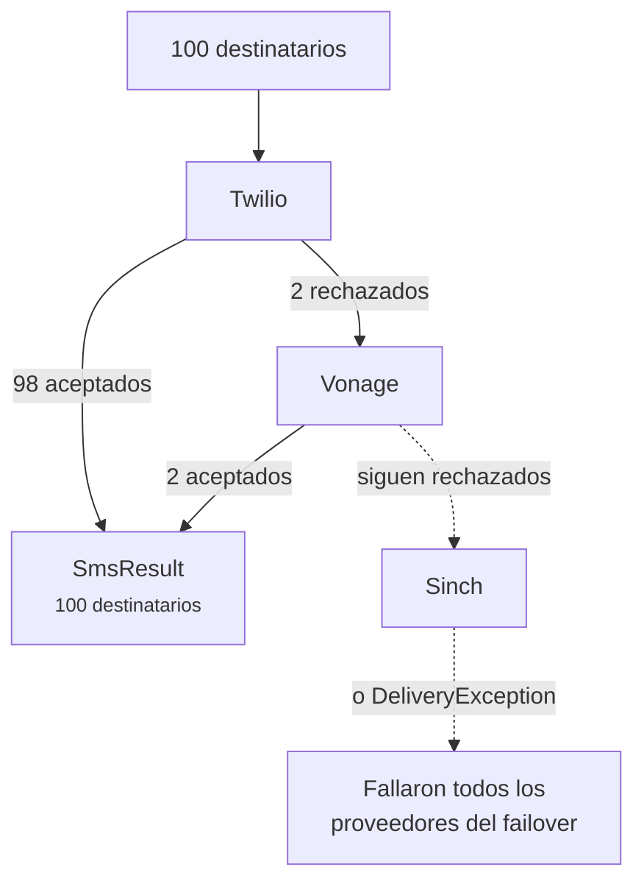

# Failover y balanceo de carga

<p class="lead">Los proveedores tienen caídas, y algunos funcionan mejor que otros según el país. Encadénalos y tus mensajes seguirán saliendo aunque uno de ellos esté caído.</p>

## Failover {#failover}

El failover es la conmutación automática a otro proveedor cuando el primero no puede enviar. Indica tus proveedores por orden de preferencia:

```ini [.env]
SMS_PROVIDER=failover
SMS_FAILOVER_DRIVERS=twilio,vonage,sinch
```

Cada mensaje va primero a Twilio. Si Twilio no puede con él, le toca a Vonage, y después a Sinch. Como siempre, cada proveedor de la cadena necesita sus propias credenciales configuradas.

También puedes usar failover en mensajes sueltos y dejar tu proveedor predeterminado como está:

```php
Sms::provider('failover')->to($phone)->message('Your code is 4821')->sendNow();
```

### Solo pasan los que fallaron {#only-the-failures-move-on}

Supón que envías a 100 personas. Twilio acepta 98 y rechaza dos números a los que su red no llega. El failover envía **solo esos dos** a Vonage. Las 98 personas que ya tienen el mensaje no lo vuelven a recibir.



```php
$result = Sms::provider('failover')->to($hundredNumbers)->message('Hi')->sendNow();

count($result);   // 100
$result->ids();   // 98 IDs de Twilio y después 2 de Vonage
```

### Qué cuenta como fallo {#what-counts-as-a-failure}

El failover pasa al siguiente cuando un proveedor:

- rechaza algunos o todos los destinatarios, o no se puede contactar con él (una `DeliveryException`),
- no está configurado o le faltan credenciales (una `InvalidConfigurationException`),
- no puede enviar ese tipo de mensaje, por ejemplo una plantilla a un proveedor que solo acepta texto (una `InvalidMessageException`).

Si fallan todos los proveedores, recibes una `DeliveryException` cuyo mensaje empieza por *All failover providers failed*. Enumera los destinatarios que nadie aceptó, y su propiedad `partial` contiene a todos los que sí recibieron el mensaje.

::: tip Pon primero tu proveedor fiable más barato
Cada destinatario va al primer proveedor que lo acepte, así que el orden también es una decisión de costes. Lo habitual es poner primero tu proveedor principal y una segunda red como respaldo.
:::

## Balanceo de carga {#load-balancing}

Para repartir el tráfico entre varios proveedores, usa `random`. Cada mensaje va a un proveedor elegido al azar de tu grupo:

```php
// config/sms.php
'random_drivers' => ['twilio', 'vonage'],
```

```ini [.env]
SMS_PROVIDER=random
```

`random` elige una vez por mensaje. Con [colas](/es/guide/queueing), eso significa una vez por destinatario, así que un lote grande se reparte de forma equilibrada. No reintenta con otro proveedor si falla; para eso usa `failover`.
