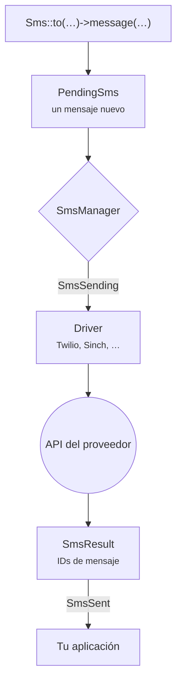

# Introducción

Laravel SMS le da a tu aplicación una única forma de enviar mensajes de texto, sea cual sea el proveedor al otro lado. Tú escribes <code>Sms::to($number)->message($text)->send()</code> y el paquete se encarga de la API del proveedor, de sus particularidades y de sus fallos.

## Por qué existe {#why-it-exists}

Casi todas las aplicaciones empiezan con un proveedor y un pequeño wrapper alrededor de su SDK. Ese wrapper va creciendo. Luego cambian los precios, un país necesita una pasarela local o la entrega a cierto operador deja de ser fiable, y el wrapper tiene que aprender a hablar con un segundo proveedor. Al final, cada aplicación acaba escribiendo la misma infraestructura: reintentos, remitentes, limpieza de números de teléfono, logs y pruebas.

Este paquete es esa infraestructura, escrita una sola vez y probada en todas las versiones de PHP y Laravel compatibles.

## Qué obtienes {#what-you-get}

- **Una API para veinte proveedores.** Twilio, Vonage, Sinch, Bird, Plivo, Telnyx, Infobip, ClickSend, Clickatell, Brevo, Bandwidth, SendPulse, Amazon SNS y WhatsApp, además de pasarelas regionales para India, Nepal y África.
- **Respuestas, no booleanos.** Un envío devuelve los IDs de mensaje del proveedor. Un fallo te dice qué números se rechazaron y cuáles salieron.
- **Failover sin duplicados.** Encadena proveedores y solo los destinatarios que un proveedor rechazó pasan al siguiente.
- **Laravel de principio a fin.** Un canal de notificaciones, jobs en cola, eventos, macros, `php artisan sms:test` y `Sms::fake()` para tus pruebas.

## El recorrido de un mensaje {#how-a-message-travels}

Cada llamada a la facade crea un mensaje completamente nuevo, así que nada se arrastra de un envío a otro, ni siquiera con Octane o en un worker de cola que lleva horas en marcha. El manager elige el proveedor: el que pediste, el predeterminado o el siguiente de una cadena de failover. El driver convierte tu mensaje en la petición HTTP del proveedor, y la respuesta de este en un `SmsResult`.

## Requisitos {#requirements}

| Laravel | PHP |
|---|---|
| 13.x | 8.3, 8.4, 8.5 |
| 12.x | 8.2, 8.3, 8.4, 8.5 |
| 11.x | 8.2, 8.3, 8.4, 8.5 |

::: warning Laravel 11
Laravel 11 ya no recibe parches de seguridad. El paquete lo sigue soportando para que las aplicaciones existentes puedan actualizar a su ritmo, pero los proyectos nuevos deberían empezar con Laravel 12 o 13.
:::

## Siguientes pasos {#next-steps}

Instala el paquete y envía tu primer mensaje: te llevará unos dos minutos.

[Instalación →](/es/guide/installation)

