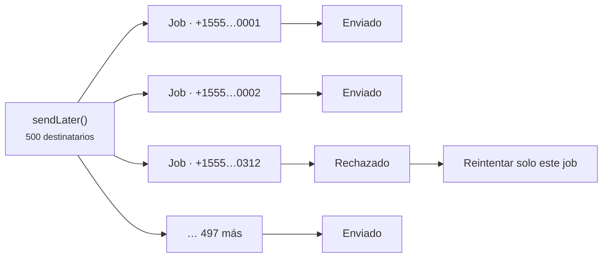

# Colas

<p class="lead">Hablar con un proveedor implica un viaje de ida y vuelta por la red, a veces lento. Encola los mensajes que envías durante una petición web para que quien usa tu aplicación nunca tenga que esperar a la red telefónica.</p>

## Enviar más tarde {#sending-later}

```php
Sms::to($user->phone)->message('Thanks for signing up!')->sendLater();
```

Para enviar en un momento concreto, pasa una fecha, un intervalo o un número de segundos:

```php
Sms::to($user->phone)
    ->message('Your appointment is in one hour.')
    ->sendLaterAt($appointment->starts_at->subHour());
```

## Encolar todo por defecto {#queue-everything-by-default}

Con `SMS_QUEUE=true`, `send()` encola en lugar de enviar de inmediato. `sendNow()` sigue enviando al momento cuando lo necesitas, por ejemplo con los códigos de inicio de sesión.

```ini [.env]
SMS_QUEUE=true
SMS_QUEUE_CONNECTION=redis
SMS_QUEUE_NAME=sms
```

Con una cola dedicada, un lote grande de mensajes de marketing no retrasa tus restablecimientos de contraseña. Pon un worker a procesarla:

```bash
php artisan queue:work redis --queue=sms
```

## Un job por destinatario {#one-job-per-recipient}

Un mensaje para 500 personas se convierte en 500 jobs pequeños, no en uno grande. Si el proveedor rechaza el número 312, solo ese job falla y se reintenta; los otros 499 destinatarios no vuelven a recibir el mensaje.



Por defecto, cada job se reintenta hasta tres veces, esperando 10, 30 y luego 60 segundos entre intentos:

```ini [.env]
SMS_QUEUE_TRIES=3
SMS_QUEUE_TIMEOUT=120
```

::: warning Mantén retry_after por encima del timeout
El `retry_after` de tu conexión de cola (en `config/queue.php`) tiene que ser mayor que `SMS_QUEUE_TIMEOUT`. Si no, un envío lento pero correcto puede acabar en manos de un segundo worker y enviarse dos veces.
:::

## Cifrado en reposo {#encrypted-at-rest}

Los jobs en cola llevan números de teléfono y el texto del mensaje, que a menudo incluye códigos de inicio de sesión. Cada `SendSmsJob` implementa `ShouldBeEncrypted` de Laravel, así que su payload se cifra con tu `APP_KEY` mientras espera en Redis, en tu base de datos o en SQS.

## Sobre los duplicados {#about-duplicates}

Separar los jobs por destinatario evita el duplicado más habitual: que un número erróneo provoque que se reenvíe a todo el mundo. Queda un caso más raro que ningún sistema de SMS puede descartar del todo: el proveedor acepta el mensaje, pero la conexión se corta antes de que llegue su respuesta. El job no puede saber que el mensaje salió, así que un reintento puede enviarlo de nuevo. La entrega es **al menos una vez** (*at least once*).

Para los mensajes en los que un duplicado sería un problema de verdad, usa pocos reintentos y guarda el ID del mensaje que recibes.
