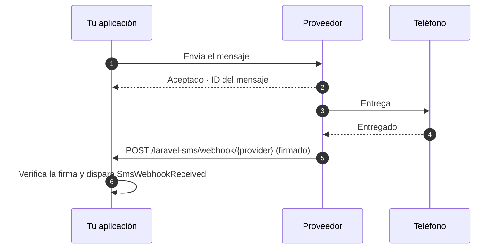

# Webhooks

<p class="lead">El resultado de un envío significa que el proveedor aceptó tu mensaje. Los webhooks te cuentan lo que pasó después: si se entregó, si falló o si la persona a la que escribiste te respondió.</p>



## Activarlos {#turning-them-on}

Los webhooks están desactivados hasta que los activas:

```ini [.env]
SMS_WEBHOOKS_ENABLED=true
```

Esto registra una ruta para todos los proveedores:

```text
POST  /laravel-sms/webhook/{provider}     name: sms.webhook
```

A cada proveedor dale la URL terminada en su propia clave, por ejemplo `https://example.com/laravel-sms/webhook/termii`.

Hay soporte de webhooks para **WhatsApp, Termii, Sendchamp, Africa's Talking y BulkSMS**.

## Cada webhook debe demostrar quién lo envía {#every-webhook-must-prove-who-sent-it}

Un endpoint de webhook es una URL pública. Sin verificación, cualquiera podría enviarle informes de entrega falsos. Por eso cada proveedor necesita un secreto, y las peticiones que no demuestran conocerlo reciben un `401`. Si el secreto no está configurado, se rechazan **todas** las peticiones: el endpoint nunca funciona sin protección.

| Proveedor | Variable | Cómo se comprueba |
|---|---|---|
| WhatsApp | `WHATSAPP_WEBHOOK_SECRET` | `X-Hub-Signature-256`, HMAC del cuerpo firmado con el secreto de tu app de Meta |
| | `WHATSAPP_VERIFY_TOKEN` | Se compara durante la verificación única por `GET` que hace Meta al suscribirte |
| Termii | `TERMII_WEBHOOK_SECRET` | `X-Termii-Signature`, HMAC-SHA512 del cuerpo |
| Sendchamp | `SENDCHAMP_WEBHOOK_SECRET` | `X-Sendchamp-Signature`, HMAC-SHA256 del cuerpo |
| BulkSMS | `BULKSMS_WEBHOOK_SECRET` | `X-BulkSMS-Signature`, HMAC-SHA256 del cuerpo |
| Africa's Talking | `AFRICASTALKING_WEBHOOK_SECRET` | Un `token` en la URL de callback (ver más abajo) |

### Africa's Talking {#africa-s-talking}

Africa's Talking no firma sus callbacks, así que el secreto va en la URL que registras con ellos:

```text
https://example.com/laravel-sms/webhook/africastalking?token=your-long-random-secret
```

El paquete compara el token en tiempo constante y después lo quita del payload, para que nunca llegue a tus listeners ni a tus logs. Usa un valor aleatorio largo, por ejemplo la salida de `php -r "echo bin2hex(random_bytes(24));"`.

### WhatsApp {#whatsapp}

WhatsApp necesita **los dos** valores. Cuando añades el webhook en el panel de Meta, Meta envía una petición `GET` con tu verify token y espera recibir de vuelta un challenge. A partir de ahí, cada informe de entrega llega como un `POST` firmado con el secreto de tu app.

## Procesar los informes {#handling-the-reports}

Cada webhook verificado dispara `SmsWebhookReceived`. Gestiónalo con un listener en `app/Listeners`, que Laravel descubre automáticamente:

```bash
php artisan make:listener UpdateSmsStatus --event="MrRijal\LaravelSms\Events\SmsWebhookReceived"
```

```php
namespace App\Listeners;

use App\Models\SmsLog;
use Illuminate\Contracts\Queue\ShouldQueue;
use MrRijal\LaravelSms\Events\SmsWebhookReceived;

class UpdateSmsStatus implements ShouldQueue
{
    public function handle(SmsWebhookReceived $event): void
    {
        SmsLog::where('provider_id', $event->messageId)
            ->update(['status' => $event->status]);
    }
}
```

Al encolar el listener, el webhook puede responder al proveedor de inmediato. Los proveedores reintentan los webhooks que tardan en responder.

| Propiedad | Contenido |
|---|---|
| `provider` | `whatsapp`, `termii`, … |
| `messageId` | El ID que recibiste al enviar, si el proveedor lo incluye |
| `status` | El estado tal como lo nombra el proveedor, por ejemplo `delivered` o `failed` |
| `recipient` | El número de teléfono al que se refiere el informe |
| `payload` | El cuerpo completo de la petición, para cualquier otra cosa que necesites |

Los nombres de los estados cambian de un proveedor a otro. Compáralos con la documentación de cada proveedor en lugar de dar por hecho un vocabulario común.

## Middleware y ruta {#middleware-and-path}

La ruta usa el grupo de middleware `api`, sin estado, y un límite de 120 peticiones por minuto. Los webhooks no tienen sesión ni token CSRF. Puedes ajustar ambas cosas en `config/sms.php`:

```php
'webhooks' => [
    'enabled' => (bool) env('SMS_WEBHOOKS_ENABLED', false),
    'prefix' => env('SMS_WEBHOOKS_PREFIX', 'laravel-sms/webhook'),
    'middleware' => ['api', 'throttle:120,1'],
    // …
],
```

Sirve los webhooks solo por HTTPS. Las firmas demuestran quién envió una petición, pero no ocultan su contenido.
