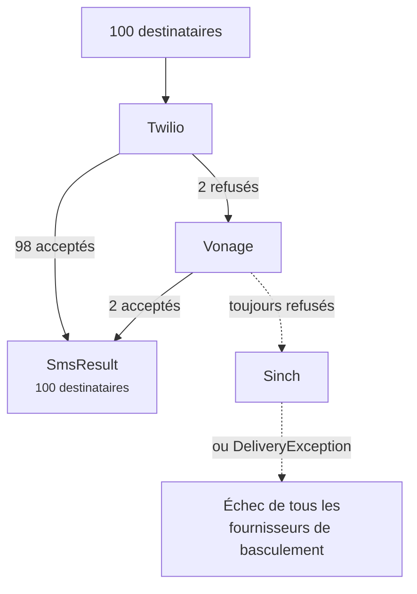

# Basculement et répartition de charge

<p class="lead">Les fournisseurs connaissent des pannes, et certains sont meilleurs que d'autres selon les pays. Enchaînez-les : vos messages continuent de partir pendant que l'un d'eux est hors service.</p>

## Basculement (failover) {#failover}

Listez vos fournisseurs par ordre de préférence :

```ini [.env]
SMS_PROVIDER=failover
SMS_FAILOVER_DRIVERS=twilio,vonage,sinch
```

Chaque message est d'abord confié à Twilio. Si Twilio ne peut pas le prendre en charge, c'est au tour de Vonage, puis de Sinch. Comme d'habitude, chaque fournisseur de la chaîne doit avoir ses propres identifiants d'accès configurés.

Vous pouvez aussi recourir au basculement pour un message isolé, sans toucher à votre fournisseur par défaut :

```php
Sms::provider('failover')->to($phone)->message('Your code is 4821')->sendNow();
```

### Seuls les échecs passent au suivant {#only-the-failures-move-on}

Imaginons un envoi à 100 personnes. Twilio en accepte 98 et refuse deux numéros que son réseau ne peut pas joindre. Le basculement envoie **uniquement ces deux-là** à Vonage. Les 98 personnes qui ont déjà le message ne le reçoivent pas une seconde fois.



```php
$result = Sms::provider('failover')->to($hundredNumbers)->message('Hi')->sendNow();

count($result);   // 100
$result->ids();   // 98 identifiants Twilio, puis 2 identifiants Vonage
```

### Ce qui compte comme un échec {#what-counts-as-a-failure}

Le basculement passe au fournisseur suivant lorsqu'un fournisseur :

- refuse tout ou partie des destinataires, ou est injoignable (une `DeliveryException`) ;
- n'est pas configuré, ou ses identifiants d'accès manquent (une `InvalidConfigurationException`) ;
- ne sait pas envoyer ce type de message, par exemple un modèle à un fournisseur qui n'accepte que du texte (une `InvalidMessageException`).

Si tous les fournisseurs échouent, vous obtenez une `DeliveryException` dont le message commence par *All failover providers failed*. Elle liste les destinataires qu'aucun fournisseur n'a acceptés, et sa propriété `partial` contient tous ceux qui ont bien reçu le message.

::: tip Placez en tête votre fournisseur fiable le moins cher
Chaque destinataire part chez le premier fournisseur qui l'accepte : l'ordre est donc aussi une décision de coût. Une configuration typique place votre fournisseur principal en premier et un second réseau en secours.
:::

## Répartition de charge {#load-balancing}

Pour répartir le trafic entre plusieurs fournisseurs, utilisez `random`. Chaque message part chez un fournisseur tiré au sort dans votre groupe :

```php
// config/sms.php
'random_drivers' => ['twilio', 'vonage'],
```

```ini [.env]
SMS_PROVIDER=random
```

`random` fait son choix une fois par message. Avec les [files d'attente](/fr/guide/queueing), cela revient à une fois par destinataire : un gros lot se répartit donc uniformément. En cas d'échec, `random` ne réessaie pas ailleurs ; c'est le rôle de `failover`.
