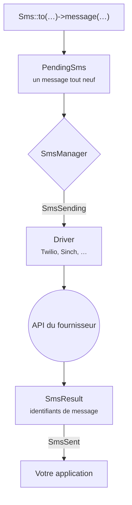

# Introduction

Laravel SMS offre à votre application une seule façon d'envoyer des SMS, quel que soit le fournisseur à l'autre bout. Vous écrivez <code>Sms::to($number)->message($text)->send()</code>, et le package se charge de l'API du fournisseur, de ses particularités et de ses pannes.

## Pourquoi ce package {#why-it-exists}

La plupart des applications démarrent avec un seul fournisseur et une petite surcouche autour de son SDK. Cette surcouche grossit. Puis les tarifs changent, un pays exige une passerelle locale, ou la livraison vers un opérateur devient capricieuse, et il faut y greffer un deuxième fournisseur. Chaque application finit par réécrire la même tuyauterie : nouvelles tentatives, identifiants d'expéditeur, nettoyage des numéros, journalisation et tests.

Ce package, c'est cette tuyauterie, écrite une bonne fois pour toutes et testée sur chaque version de PHP et de Laravel prise en charge.

## Ce que vous y gagnez {#what-you-get}

- **Une seule API pour vingt fournisseurs.** Twilio, Vonage, Sinch, Bird, Plivo, Telnyx, Infobip, ClickSend, Clickatell, Brevo, Bandwidth, SendPulse, Amazon SNS et WhatsApp, ainsi que des passerelles régionales pour l'Inde, le Népal et l'Afrique.
- **Des réponses, pas des booléens.** Un envoi renvoie les identifiants de message du fournisseur. En cas d'échec, vous savez quels numéros ont été refusés et lesquels sont passés.
- **Un basculement sans doublons.** Enchaînez plusieurs fournisseurs : seuls les destinataires refusés par l'un passent au suivant.
- **Du Laravel de bout en bout.** Un canal de notification, des jobs en file d'attente, des événements, des macros, `php artisan sms:test`, et `Sms::fake()` pour vos tests.

## Le parcours d'un message {#how-a-message-travels}

Chaque appel à la façade crée un message entièrement neuf : rien ne fuit d'un envoi à l'autre, même sous Octane ou dans un worker de file d'attente qui tourne longtemps. Le manager choisit le fournisseur : celui que vous avez demandé, celui par défaut, ou le suivant dans une chaîne de basculement. Le driver traduit votre message en requête HTTP pour le fournisseur, puis transforme sa réponse en `SmsResult`.

## Prérequis {#requirements}

| Laravel | PHP |
|---|---|
| 13.x | 8.3, 8.4, 8.5 |
| 12.x | 8.2, 8.3, 8.4, 8.5 |
| 11.x | 8.2, 8.3, 8.4, 8.5 |

::: warning Laravel 11
Laravel 11 ne reçoit plus de correctifs de sécurité. Le package le prend encore en charge pour que les applications existantes puissent migrer à leur rythme, mais un nouveau projet devrait démarrer sur Laravel 12 ou 13.
:::

## Et ensuite ? {#next-steps}

Installez le package et envoyez votre premier message : comptez environ deux minutes.

[Installation →](/fr/guide/installation)

