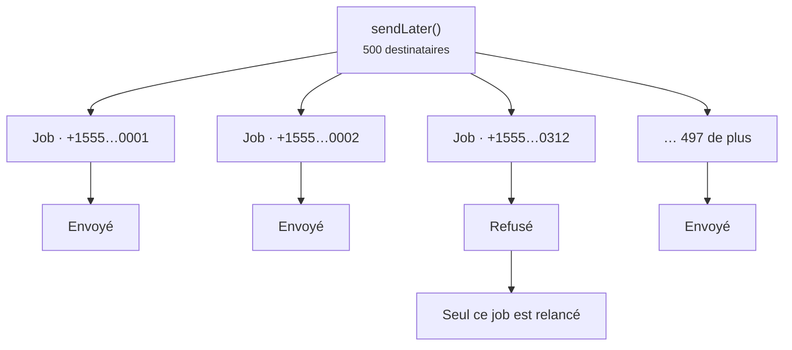

# Files d'attente

<p class="lead">Dialoguer avec un fournisseur demande un aller-retour réseau, parfois lent. Mettez en file d'attente les messages envoyés pendant une requête web : les utilisateurs de votre application n'auront jamais à attendre un réseau téléphonique.</p>

## Envoyer plus tard {#sending-later}

```php
Sms::to($user->phone)->message('Thanks for signing up!')->sendLater();
```

Pour envoyer à un moment précis, passez une date, un intervalle ou un nombre de secondes :

```php
Sms::to($user->phone)
    ->message('Your appointment is in one hour.')
    ->sendLaterAt($appointment->starts_at->subHour());
```

## Tout mettre en file d'attente par défaut {#queue-everything-by-default}

Avec `SMS_QUEUE=true`, `send()` met en file d'attente au lieu d'envoyer immédiatement. `sendNow()` continue d'envoyer sur-le-champ quand vous en avez besoin, pour les codes de connexion par exemple.

```ini [.env]
SMS_QUEUE=true
SMS_QUEUE_CONNECTION=redis
SMS_QUEUE_NAME=sms
```

Sous Laravel 13, vous pouvez plutôt router le job du package depuis `AppServiceProvider`, à côté de vos autres règles de routage de files :

```php
use Illuminate\Support\Facades\Queue;
use MrRijal\LaravelSms\Jobs\SendSmsJob;

public function boot(): void
{
    Queue::route(SendSmsJob::class, connection: 'redis', queue: 'sms');
}
```

Une file dédiée évite qu'un gros lot de messages marketing ne retarde vos réinitialisations de mot de passe. Lancez un worker pour elle :

```bash
php artisan queue:work redis --queue=sms
```

## Un job par destinataire {#one-job-per-recipient}

Un message adressé à 500 personnes devient 500 petits jobs, et non un seul gros. Si le fournisseur refuse le 312ᵉ numéro, seul ce job échoue et est relancé ; les 499 autres destinataires ne reçoivent jamais le message une seconde fois.



Par défaut, chaque job est tenté jusqu'à trois fois, avec une attente de 10, puis 30, puis 60 secondes entre les tentatives :

```ini [.env]
SMS_QUEUE_TRIES=3
SMS_QUEUE_TIMEOUT=120
```

::: warning Gardez retry_after au-dessus du timeout
Le `retry_after` de votre connexion de file d'attente (dans `config/queue.php`) doit être plus long que `SMS_QUEUE_TIMEOUT`. Sinon, un envoi lent mais réussi peut être repris par un second worker et partir deux fois.
:::

## Chiffrés au repos {#encrypted-at-rest}

Les jobs en file d'attente transportent des numéros de téléphone et le texte des messages, qui contient souvent des codes de connexion. Chaque `SendSmsJob` implémente l'interface `ShouldBeEncrypted` de Laravel : sa charge utile (payload) est chiffrée avec votre `APP_KEY` tant qu'elle séjourne dans Redis, dans votre base de données ou dans SQS.

## À propos des doublons {#about-duplicates}

Découper les jobs par destinataire élimine le doublon le plus courant : un seul mauvais numéro qui provoque un nouvel envoi à tout le monde. Il reste un cas plus rare, qu'aucun système d'envoi de SMS ne peut exclure complètement : le fournisseur accepte le message, mais la connexion coupe avant que sa réponse n'arrive. Le job ne peut pas savoir que le message est parti, et une nouvelle tentative risque de l'envoyer une seconde fois. La livraison est garantie **au moins une fois** (at least once).

Pour les messages où un doublon poserait vraiment problème, limitez le nombre de tentatives et conservez l'identifiant du message qui vous est renvoyé.
