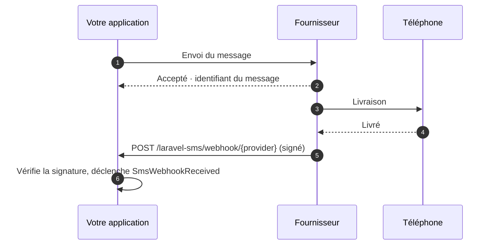

# Webhooks

<p class="lead">Le résultat d'un envoi vous apprend que le fournisseur a accepté votre message. Les webhooks vous disent la suite : livré, en échec, ou une réponse de la personne à qui vous avez écrit.</p>



## Les activer {#turning-them-on}

Les webhooks sont désactivés tant que vous ne les activez pas :

```ini [.env]
SMS_WEBHOOKS_ENABLED=true
```

Une seule route est alors enregistrée pour tous les fournisseurs :

```text
POST  /laravel-sms/webhook/{provider}     name: sms.webhook
```

Donnez à chaque fournisseur l'URL terminée par sa propre clé, par exemple `https://example.com/laravel-sms/webhook/termii`.

Les webhooks sont pris en charge pour **WhatsApp, Termii, Sendchamp, Africa's Talking et BulkSMS**.

## Chaque webhook doit prouver son origine {#every-webhook-must-prove-who-sent-it}

Un endpoint de webhook est une URL publique. Sans vérification, n'importe qui pourrait y poster de faux accusés de réception. Chaque fournisseur a donc besoin d'un secret, et toute requête incapable de prouver qu'elle le connaît reçoit une `401`. Si le secret n'est pas configuré, **toutes** les requêtes sont rejetées : l'endpoint ne tourne jamais sans protection.

| Fournisseur | Variable | Vérification |
|---|---|---|
| WhatsApp | `WHATSAPP_WEBHOOK_SECRET` | HMAC `X-Hub-Signature-256` du corps, signé avec le secret de votre application Meta |
| | `WHATSAPP_VERIFY_TOKEN` | Comparé lors de la vérification `GET` unique effectuée par Meta à l'abonnement |
| Termii | `TERMII_WEBHOOK_SECRET` | `X-Termii-Signature`, HMAC-SHA512 du corps |
| Sendchamp | `SENDCHAMP_WEBHOOK_SECRET` | `X-Sendchamp-Signature`, HMAC-SHA256 du corps |
| BulkSMS | `BULKSMS_WEBHOOK_SECRET` | `X-BulkSMS-Signature`, HMAC-SHA256 du corps |
| Africa's Talking | `AFRICASTALKING_WEBHOOK_SECRET` | Un `token` dans l'URL de callback (voir ci-dessous) |

### Africa's Talking {#africa-s-talking}

Africa's Talking ne signe pas ses callbacks : le secret se place donc dans l'URL que vous enregistrez chez eux.

```text
https://example.com/laravel-sms/webhook/africastalking?token=your-long-random-secret
```

Le package compare le token en temps constant, puis le retire de la charge utile pour qu'il n'atteigne jamais vos listeners ni vos journaux. Choisissez une longue valeur aléatoire, par exemple la sortie de `php -r "echo bin2hex(random_bytes(24));"`.

### WhatsApp {#whatsapp}

WhatsApp a besoin des **deux** valeurs. Quand vous ajoutez le webhook dans le tableau de bord Meta, Meta envoie une requête `GET` contenant votre verify token et attend un challenge en retour. Ensuite, chaque accusé de réception arrive sous forme de `POST` signé avec le secret de votre application.

## Traiter les accusés de réception {#handling-the-reports}

Chaque webhook vérifié déclenche `SmsWebhookReceived`. Traitez-le avec un listener placé dans `app/Listeners`, que Laravel découvre automatiquement :

```bash
php artisan make:listener UpdateSmsStatus --event="MrRijal\LaravelSms\Events\SmsWebhookReceived"
```

```php
namespace App\Listeners;

use App\Models\SmsLog;
use Illuminate\Contracts\Queue\ShouldQueue;
use MrRijal\LaravelSms\Events\SmsWebhookReceived;

class UpdateSmsStatus implements ShouldQueue
{
    public function handle(SmsWebhookReceived $event): void
    {
        SmsLog::where('provider_id', $event->messageId)
            ->update(['status' => $event->status]);
    }
}
```

Mettre le listener en file d'attente permet au webhook de répondre immédiatement au fournisseur. Les fournisseurs renvoient les webhooks qui tardent à répondre.

| Propriété | Contenu |
|---|---|
| `provider` | `whatsapp`, `termii`, … |
| `messageId` | L'identifiant reçu lors de l'envoi, quand le fournisseur l'inclut |
| `status` | Le statut tel que le fournisseur le formule, par exemple `delivered` ou `failed` |
| `recipient` | Le numéro de téléphone concerné par l'accusé |
| `payload` | Le corps complet de la requête, pour tout le reste |

Les statuts varient d'un fournisseur à l'autre. Comparez-les à la documentation du fournisseur plutôt que de supposer un vocabulaire commun.

## Middleware et chemin {#middleware-and-path}

La route utilise le groupe de middlewares `api`, sans état, et une limite de 120 requêtes par minute. Les webhooks n'ont ni session ni jeton CSRF. Vous pouvez ajuster les deux dans `config/sms.php` :

```php
'webhooks' => [
    'enabled' => (bool) env('SMS_WEBHOOKS_ENABLED', false),
    'prefix' => env('SMS_WEBHOOKS_PREFIX', 'laravel-sms/webhook'),
    'middleware' => ['api', 'throttle:120,1'],
    // …
],
```

Servez les webhooks uniquement en HTTPS. Les signatures prouvent l'origine d'une requête, mais n'en masquent pas le contenu.
