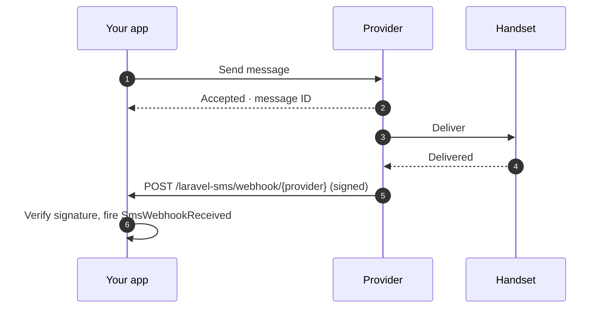

# Webhooks

<p class="lead">A send result means the provider accepted your message. Webhooks tell you what happened next: delivered, failed, or a reply from the person you texted.</p>



## Turning them on

Webhooks are off until you enable them:

```ini [.env]
SMS_WEBHOOKS_ENABLED=true
```

That registers one route for every provider:

```text
POST  /laravel-sms/webhook/{provider}     name: sms.webhook
```

Give each provider the URL with its own key at the end, for example `https://example.com/laravel-sms/webhook/termii`.

Webhooks are supported for **WhatsApp, Termii, Sendchamp, Africa's Talking and BulkSMS**.

## Every webhook must prove who sent it

A webhook endpoint is a public URL. Without verification, anyone could post fake delivery reports to it. So each provider needs a secret, and requests that can't prove they know it get a `401`. If the secret isn't configured, **every** request is rejected: the endpoint never runs unprotected.

| Provider | Variable | How it's checked |
|---|---|---|
| WhatsApp | `WHATSAPP_WEBHOOK_SECRET` | `X-Hub-Signature-256` HMAC of the body, signed with your Meta app secret |
| | `WHATSAPP_VERIFY_TOKEN` | Compared during Meta's one-time `GET` subscription check |
| Termii | `TERMII_WEBHOOK_SECRET` | `X-Termii-Signature`, HMAC-SHA512 of the body |
| Sendchamp | `SENDCHAMP_WEBHOOK_SECRET` | `X-Sendchamp-Signature`, HMAC-SHA256 of the body |
| BulkSMS | `BULKSMS_WEBHOOK_SECRET` | `X-BulkSMS-Signature`, HMAC-SHA256 of the body |
| Africa's Talking | `AFRICASTALKING_WEBHOOK_SECRET` | A `token` in the callback URL (see below) |

### Africa's Talking

Africa's Talking doesn't sign its callbacks, so the secret goes in the URL you register with them:

```text
https://example.com/laravel-sms/webhook/africastalking?token=your-long-random-secret
```

The package compares the token in constant time, then removes it from the payload so it never reaches your listeners or your logs. Use a long random value, for example the output of `php -r "echo bin2hex(random_bytes(24));"`.

### WhatsApp

WhatsApp needs **both** values. When you add the webhook in the Meta dashboard, Meta sends a `GET` request with your verify token and expects a challenge back. After that, every delivery report arrives as a `POST` signed with your app secret.

## Handling the reports

Each verified webhook fires `SmsWebhookReceived`. Handle it with a listener in `app/Listeners`, which Laravel discovers automatically:

```bash
php artisan make:listener UpdateSmsStatus --event="MrRijal\LaravelSms\Events\SmsWebhookReceived"
```

```php
namespace App\Listeners;

use App\Models\SmsLog;
use Illuminate\Contracts\Queue\ShouldQueue;
use MrRijal\LaravelSms\Events\SmsWebhookReceived;

class UpdateSmsStatus implements ShouldQueue
{
    public function handle(SmsWebhookReceived $event): void
    {
        SmsLog::where('provider_id', $event->messageId)
            ->update(['status' => $event->status]);
    }
}
```

Queueing the listener lets the webhook answer the provider immediately. Providers retry webhooks that respond slowly.

| Property | Contents |
|---|---|
| `provider` | `whatsapp`, `termii`, … |
| `messageId` | The ID you got back from the send, when the provider includes it |
| `status` | The provider's own status word, such as `delivered` or `failed` |
| `recipient` | The phone number the report is about |
| `payload` | The full request body, for anything else you need |

Status words differ between providers. Compare them against the provider's documentation rather than assuming one vocabulary.

## Middleware and path

The route uses the stateless `api` middleware group and a rate limit of 120 requests a minute. Webhooks have no session or CSRF token. Adjust both in `config/sms.php`:

```php
'webhooks' => [
    'enabled' => (bool) env('SMS_WEBHOOKS_ENABLED', false),
    'prefix' => env('SMS_WEBHOOKS_PREFIX', 'laravel-sms/webhook'),
    'middleware' => ['api', 'throttle:120,1'],
    // …
],
```

Serve webhooks over HTTPS only. Signatures prove who sent a request, but they don't hide its contents.
