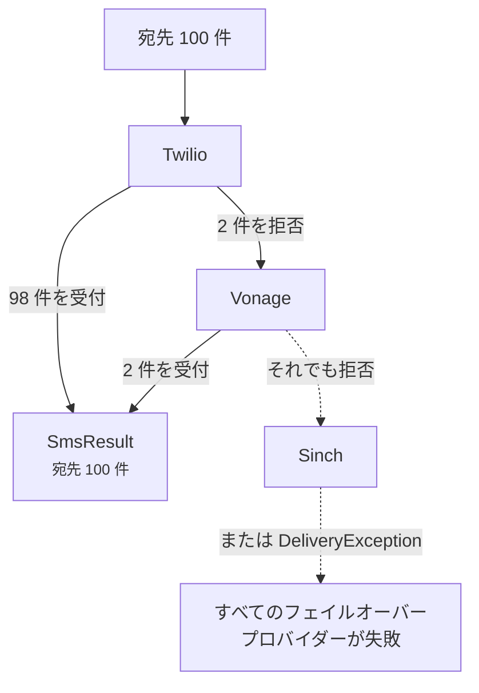

# フェイルオーバーと負荷分散

<p class="lead">プロバイダーにも障害はありますし、国によって得意不得意もあります。複数のプロバイダーをチェーンでつないでおけば、どれか 1 つが止まってもメッセージは送られ続けます。</p>

## フェイルオーバー {#failover}

プロバイダーを優先順に並べます。

```ini [.env]
SMS_PROVIDER=failover
SMS_FAILOVER_DRIVERS=twilio,vonage,sinch
```

メッセージはまず Twilio に送られます。Twilio が受け付けられなければ次は Vonage、その次は Sinch の番です。チェーン内の各プロバイダーには、いつもどおりそれぞれの認証情報を設定しておく必要があります。

デフォルトはそのままにして、個別のメッセージだけフェイルオーバーで送ることもできます。

```php
Sms::provider('failover')->to($phone)->message('Your code is 4821')->sendNow();
```

### 次に回るのは失敗した分だけ {#only-the-failures-move-on}

100 人に送信したとします。Twilio は 98 件を受け付け、自社の回線では届けられない 2 件の番号を拒否しました。このときフェイルオーバーが Vonage に送るのは、**その 2 件だけ**です。すでにメッセージを受け取った 98 人に、もう一度届くことはありません。



```php
$result = Sms::provider('failover')->to($hundredNumbers)->message('Hi')->sendNow();

count($result);   // 100
$result->ids();   // Twilio の ID が 98 件、続いて Vonage の ID が 2 件
```

### 何を失敗とみなすか {#what-counts-as-a-failure}

次のような場合、フェイルオーバーは次のプロバイダーに進みます。

- 一部またはすべての宛先を拒否した、あるいは接続できなかった（`DeliveryException`）
- 設定されていない、または認証情報が不足している（`InvalidConfigurationException`）
- その種類のメッセージを送れない。たとえば本文のみ対応のプロバイダーにテンプレートを送ろうとした場合（`InvalidMessageException`）

すべてのプロバイダーが失敗すると、*All failover providers failed* で始まる `DeliveryException` がスローされます。この例外には、どのプロバイダーにも受け付けられなかった宛先が列挙され、`partial` プロパティにはメッセージを受け取れた全員が入っています。

::: tip 安くて信頼できるプロバイダーを先頭に
各宛先は受け付けてくれた最初のプロバイダーから送られるので、並び順はそのままコストの判断でもあります。メインのプロバイダーを先頭に置き、別の回線をバックアップにするのが一般的な構成です。
:::

## 負荷分散 {#load-balancing}

トラフィックを複数のプロバイダーに分散させたいときは `random` を使います。各メッセージは、プールの中からランダムに選ばれた 1 つのプロバイダーで送信されます。

```php
// config/sms.php
'random_drivers' => ['twilio', 'vonage'],
```

```ini [.env]
SMS_PROVIDER=random
```

`random` がプロバイダーを選ぶのはメッセージごとに 1 回です。[キュー](/ja/guide/queueing)と組み合わせれば宛先ごとに 1 回になるので、大量の送信も均等に分散されます。失敗しても別のプロバイダーでリトライはしません。それが必要なら `failover` を使ってください。
