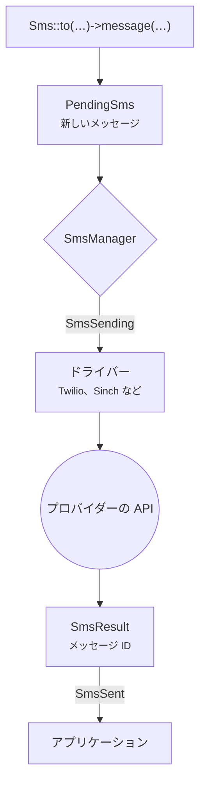

# このパッケージについて

Laravel SMS は、相手がどのプロバイダーであっても、アプリケーションから同じ書き方で SMS を送れるようにするパッケージです。<code>Sms::to($number)->message($text)->send()</code> と書くだけで、プロバイダーの API との通信も、その癖も、失敗時の対応もパッケージが引き受けます。

## なぜ作ったのか {#why-it-exists}

多くのアプリケーションは、1 社のプロバイダーとその SDK を包む小さなラッパーから始まります。そのラッパーは少しずつ大きくなっていきます。やがて料金が変わったり、ある国ではその国のゲートウェイが必要になったり、特定のキャリアへの配信が不安定になったりして、ラッパーに 2 社目のプロバイダーを追加することになります。リトライ、送信元 ID、電話番号の整形、ログ、テスト。どのアプリも結局、同じ下回りの処理を書くことになるのです。

このパッケージは、その下回りを一度だけ書き、サポート対象のすべての PHP と Laravel のバージョンでテストしたものです。

## 何ができるのか {#what-you-get}

- **20 社のプロバイダーをひとつの API で。** Twilio、Vonage、Sinch、Bird、Plivo、Telnyx、Infobip、ClickSend、Clickatell、Brevo、Bandwidth、SendPulse、Amazon SNS、WhatsApp に加え、インド、ネパール、アフリカの地域ゲートウェイにも対応しています。
- **true / false ではなく、中身のある答えを。** 送信するとプロバイダーのメッセージ ID が返ります。失敗したときは、どの番号が拒否され、どの番号に届いたのかがわかります。
- **重複送信のないフェイルオーバー。** プロバイダーをチェーンでつなぐと、あるプロバイダーが拒否した宛先だけが次のプロバイダーに回ります。
- **隅々まで Laravel 流。** 通知チャネル、キュージョブ、イベント、マクロ、`php artisan sms:test`、そしてテスト用の `Sms::fake()` がそろっています。

## メッセージが届くまでの流れ {#how-a-message-travels}

ファサードを呼ぶたびにまっさらなメッセージが作られるので、Octane 上でも、長時間動き続けるキューワーカーの中でも、前の送信の状態が次に持ち越されることはありません。どのプロバイダーを使うかはマネージャーが決めます。明示的に指定したもの、デフォルトのもの、あるいはフェイルオーバーチェーンの次のもののいずれかです。ドライバーはメッセージをプロバイダー向けの HTTP リクエストに変換し、そのレスポンスを `SmsResult` に変換して返します。

## 動作要件 {#requirements}

| Laravel | PHP |
|---|---|
| 13.x | 8.3, 8.4, 8.5 |
| 12.x | 8.2, 8.3, 8.4, 8.5 |
| 11.x | 8.2, 8.3, 8.4, 8.5 |

::: warning Laravel 11
Laravel 11 はすでにセキュリティ修正の提供が終わっています。既存のアプリケーションが自分のペースでアップグレードできるよう、このパッケージでは引き続きサポートしていますが、新しいプロジェクトは Laravel 12 か 13 で始めてください。
:::

## 次のステップ {#next-steps}

パッケージをインストールして、最初のメッセージを送ってみましょう。2 分ほどで終わります。

[インストール →](/ja/guide/installation)

