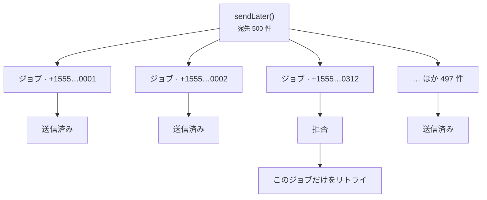

# キューで送る

<p class="lead">プロバイダーとのやり取りにはネットワークの往復が必要で、ときには時間もかかります。Web リクエストの中で送るメッセージはキューに入れて、アプリを使う人が電話網を待たされないようにしましょう。</p>

## 後で送る {#sending-later}

```php
Sms::to($user->phone)->message('Thanks for signing up!')->sendLater();
```

送信時刻を指定したいときは、日時、時間間隔、または秒数を渡します。

```php
Sms::to($user->phone)
    ->message('Your appointment is in one hour.')
    ->sendLaterAt($appointment->starts_at->subHour());
```

## デフォルトですべてキューに入れる {#queue-everything-by-default}

`SMS_QUEUE=true` を設定すると、`send()` はすぐに送信せずキューに入れるようになります。ログインコードのように今すぐ送りたいものは、これまでどおり `sendNow()` で即座に送信できます。

```ini [.env]
SMS_QUEUE=true
SMS_QUEUE_CONNECTION=redis
SMS_QUEUE_NAME=sms
```

Laravel 13 なら、ほかのキューのルーティングと並べて、`AppServiceProvider` でパッケージのジョブをルーティングすることもできます。

```php
use Illuminate\Support\Facades\Queue;
use MrRijal\LaravelSms\Jobs\SendSmsJob;

public function boot(): void
{
    Queue::route(SendSmsJob::class, connection: 'redis', queue: 'sms');
}
```

SMS 専用のキューを用意しておけば、大量のマーケティングメッセージのせいでパスワードリセットが遅れることもありません。そのキュー用のワーカーを起動します。

```bash
php artisan queue:work redis --queue=sms
```

## 宛先ごとに 1 ジョブ {#one-job-per-recipient}

500 人宛てのメッセージは、1 つの大きなジョブではなく、500 個の小さなジョブになります。プロバイダーが 312 番目の番号を拒否しても、失敗してリトライされるのはそのジョブだけで、残りの 499 人に同じメッセージが再送されることはありません。



各ジョブはデフォルトで最大 3 回まで試行され、試行の間には 10 秒、30 秒、60 秒と待機します。

```ini [.env]
SMS_QUEUE_TRIES=3
SMS_QUEUE_TIMEOUT=120
```

::: warning retry_after はタイムアウトより長くする
キュー接続の `retry_after`（`config/queue.php` 内）は `SMS_QUEUE_TIMEOUT` より長くしてください。そうしないと、時間はかかったものの成功していた送信を 2 つ目のワーカーが拾ってしまい、2 回送信されることがあります。
:::

## 保存時は暗号化 {#encrypted-at-rest}

キューのジョブには電話番号とメッセージ本文が含まれ、本文にはログインコードが入っていることもよくあります。すべての `SendSmsJob` は Laravel の `ShouldBeEncrypted` を実装しているので、Redis やデータベース、SQS に置かれている間、ペイロードは `APP_KEY` で暗号化されています。

## 重複送信について {#about-duplicates}

ジョブを宛先ごとに分けることで、よくある重複、つまり 1 件の不正な番号のせいで全員に再送されてしまう事態は防げます。ただ、まれなケースが 1 つだけ残り、これはどの SMS システムでも完全には防げません。プロバイダーがメッセージを受け付けたのに、その応答が返ってくる前に接続が切れてしまうケースです。ジョブ側からは送信できたかどうかがわからないので、リトライで同じメッセージがもう一度送られる可能性があります。つまり配信は**少なくとも 1 回（at least once）**の保証です。

重複が本当に問題になるメッセージでは、リトライ回数を少なくし、返ってきたメッセージ ID を保存しておきましょう。
