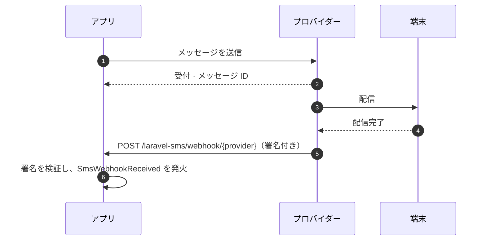

# Webhook

<p class="lead">送信結果からわかるのは、プロバイダーがメッセージを受け付けたということまでです。その後どうなったのか、つまり届いたのか、失敗したのか、相手から返信があったのかは Webhook が教えてくれます。</p>



## 有効にする {#turning-them-on}

Webhook は、有効にするまでオフになっています。

```ini [.env]
SMS_WEBHOOKS_ENABLED=true
```

これで、全プロバイダー共通のルートが 1 つ登録されます。

```text
POST  /laravel-sms/webhook/{provider}     name: sms.webhook
```

各プロバイダーには、末尾にそのプロバイダーのキーを付けた URL を登録します。たとえば `https://example.com/laravel-sms/webhook/termii` のようになります。

Webhook に対応しているのは **WhatsApp、Termii、Sendchamp、Africa's Talking、BulkSMS** です。

## Webhook には送信元の証明が必須 {#every-webhook-must-prove-who-sent-it}

Webhook のエンドポイントは公開された URL です。検証がなければ、誰でも偽の配信レポートを送りつけられてしまいます。そのため各プロバイダーにはシークレットが必要で、それを知っていることを証明できないリクエストには `401` を返します。シークレットが設定されていなければ、**すべての**リクエストを拒否します。エンドポイントが無防備な状態で動くことはありません。

| プロバイダー | 変数 | 検証方法 |
|---|---|---|
| WhatsApp | `WHATSAPP_WEBHOOK_SECRET` | `X-Hub-Signature-256`。Meta アプリシークレットで署名された本文の HMAC |
| | `WHATSAPP_VERIFY_TOKEN` | Meta が最初に一度だけ行う `GET` のサブスクリプション確認時に照合 |
| Termii | `TERMII_WEBHOOK_SECRET` | `X-Termii-Signature`。本文の HMAC-SHA512 |
| Sendchamp | `SENDCHAMP_WEBHOOK_SECRET` | `X-Sendchamp-Signature`。本文の HMAC-SHA256 |
| BulkSMS | `BULKSMS_WEBHOOK_SECRET` | `X-BulkSMS-Signature`。本文の HMAC-SHA256 |
| Africa's Talking | `AFRICASTALKING_WEBHOOK_SECRET` | コールバック URL 内の `token`（下記参照） |

### Africa's Talking {#africa-s-talking}

Africa's Talking はコールバックに署名しないので、シークレットは登録する URL に含めます。

```text
https://example.com/laravel-sms/webhook/africastalking?token=your-long-random-secret
```

パッケージはトークンを定数時間で比較し、その後ペイロードから取り除きます。リスナーやログにトークンが渡ることはありません。値には長いランダムな文字列を使ってください。たとえば `php -r "echo bin2hex(random_bytes(24));"` の出力などです。

### WhatsApp {#whatsapp}

WhatsApp では**両方**の値が必要です。Meta のダッシュボードで Webhook を追加すると、Meta は検証トークン付きの `GET` リクエストを送り、challenge が返ってくることを確認します。それ以降、配信レポートはすべてアプリシークレットで署名された `POST` で届きます。

## レポートを処理する {#handling-the-reports}

検証を通過した Webhook はそれぞれ `SmsWebhookReceived` を発火します。`app/Listeners` にリスナーを置けば、Laravel が自動で検出してくれます。

```bash
php artisan make:listener UpdateSmsStatus --event="MrRijal\LaravelSms\Events\SmsWebhookReceived"
```

```php
namespace App\Listeners;

use App\Models\SmsLog;
use Illuminate\Contracts\Queue\ShouldQueue;
use MrRijal\LaravelSms\Events\SmsWebhookReceived;

class UpdateSmsStatus implements ShouldQueue
{
    public function handle(SmsWebhookReceived $event): void
    {
        SmsLog::where('provider_id', $event->messageId)
            ->update(['status' => $event->status]);
    }
}
```

リスナーをキューに入れておけば、Webhook はプロバイダーにすぐ応答を返せます。応答が遅い Webhook は、プロバイダーがリトライしてしまうからです。

| プロパティ | 内容 |
|---|---|
| `provider` | `whatsapp`、`termii` など |
| `messageId` | 送信時に返ってきた ID（プロバイダーが含めている場合） |
| `status` | `delivered` や `failed` など、プロバイダー独自のステータス文字列 |
| `recipient` | レポートの対象となる電話番号 |
| `payload` | リクエスト本文全体。ほかに必要な情報があればここから |

ステータス文字列はプロバイダーごとに異なります。共通の語彙があると決めつけず、各プロバイダーのドキュメントと照らし合わせてください。

## ミドルウェアとパス {#middleware-and-path}

このルートは、ステートレスな `api` ミドルウェアグループと、1 分あたり 120 リクエストのレート制限を使います。Webhook にはセッションも CSRF トークンもありません。どちらも `config/sms.php` で変更できます。

```php
'webhooks' => [
    'enabled' => (bool) env('SMS_WEBHOOKS_ENABLED', false),
    'prefix' => env('SMS_WEBHOOKS_PREFIX', 'laravel-sms/webhook'),
    'middleware' => ['api', 'throttle:120,1'],
    // …
],
```

Webhook は必ず HTTPS で受けてください。署名で証明できるのは誰がリクエストを送ったかであって、中身を隠してくれるわけではありません。
