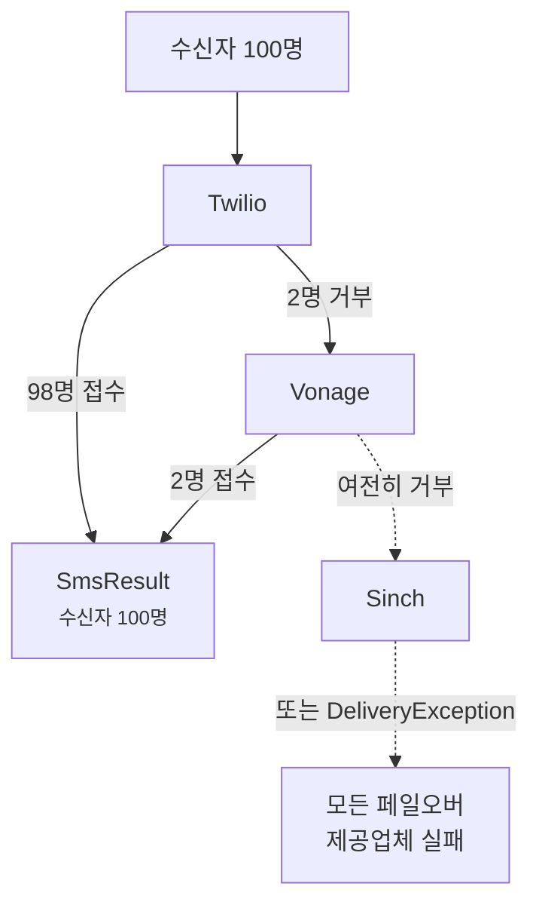

# 페일오버와 부하 분산

<p class="lead">제공업체에도 장애는 생기고, 국가마다 더 잘 맞는 제공업체가 따로 있습니다. 여러 제공업체를 체인으로 연결해 두면 그중 하나가 멈춰도 메시지는 계속 나갑니다.</p>

## 페일오버 {#failover}

선호하는 순서대로 제공업체를 나열하세요.

```ini [.env]
SMS_PROVIDER=failover
SMS_FAILOVER_DRIVERS=twilio,vonage,sinch
```

모든 메시지는 먼저 Twilio로 갑니다. Twilio가 받아 주지 않으면 Vonage, 그다음은 Sinch 차례입니다. 체인에 들어간 제공업체는 평소처럼 각자 인증 정보가 설정되어 있어야 합니다.

기본 설정은 그대로 두고 개별 메시지에만 페일오버를 쓸 수도 있습니다.

```php
Sms::provider('failover')->to($phone)->message('Your code is 4821')->sendNow();
```

### 실패한 수신자만 넘어갑니다 {#only-the-failures-move-on}

100명에게 보낸다고 해 봅시다. Twilio가 98명은 받아들이고, 자기 네트워크로 닿을 수 없는 번호 두 개를 거부합니다. 페일오버는 **그 두 명만** Vonage로 보냅니다. 이미 메시지를 받은 98명은 다시 받지 않습니다.



```php
$result = Sms::provider('failover')->to($hundredNumbers)->message('Hi')->sendNow();

count($result);   // 100
$result->ids();   // Twilio ID 98개, 이어서 Vonage ID 2개
```

### 무엇을 실패로 보나 {#what-counts-as-a-failure}

다음과 같은 경우 페일오버는 다음 제공업체로 넘어갑니다.

- 제공업체가 수신자 일부 또는 전체를 거부했거나, 연결할 수 없을 때 (`DeliveryException`)
- 제공업체가 설정되지 않았거나 인증 정보가 없을 때 (`InvalidConfigurationException`)
- 제공업체가 이런 종류의 메시지를 보낼 수 없을 때. 예를 들어 본문만 지원하는 제공업체에 템플릿을 보낸 경우 (`InvalidMessageException`)

모든 제공업체가 실패하면 *All failover providers failed*로 시작하는 `DeliveryException`이 발생합니다. 이 예외에는 어느 제공업체도 받아 주지 않은 수신자 목록이 담기고, `partial` 속성에는 메시지를 받은 모든 사람이 담깁니다.

::: tip 저렴하면서 안정적인 제공업체를 맨 앞에
모든 수신자는 받아 주는 첫 번째 제공업체로 가므로, 순서는 곧 비용 결정이기도 합니다. 보통은 주력 제공업체를 맨 앞에, 다른 네트워크를 백업으로 둡니다.
:::

## 부하 분산 {#load-balancing}

여러 제공업체에 트래픽을 나누려면 `random`을 쓰세요. 각 메시지는 풀에서 무작위로 고른 제공업체 하나로 갑니다.

```php
// config/sms.php
'random_drivers' => ['twilio', 'vonage'],
```

```ini [.env]
SMS_PROVIDER=random
```

`random`은 메시지마다 한 번 고릅니다. [큐](/ko/guide/queueing)를 쓰면 수신자마다 한 번 고르는 셈이므로 대량 발송이 고르게 분산됩니다. 실패했을 때 다른 제공업체로 재시도하지는 않으니, 그게 필요하다면 `failover`를 쓰세요.
