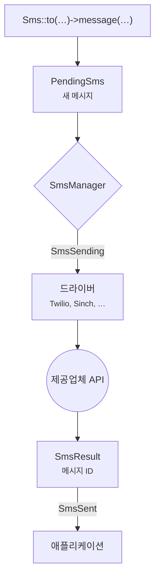

# 소개

Laravel SMS를 쓰면 어떤 제공업체를 쓰든 애플리케이션에서 문자를 보내는 방법은 하나뿐입니다. <code>Sms::to($number)->message($text)->send()</code>라고 쓰기만 하면, 제공업체의 API와 그 특이한 동작, 그리고 실패 처리는 패키지가 맡습니다.

## 왜 만들었나 {#why-it-exists}

대부분의 애플리케이션은 제공업체 하나와 그 SDK를 감싼 작은 래퍼로 시작합니다. 그 래퍼는 점점 커집니다. 그러다 요금이 바뀌거나, 특정 국가에 현지 게이트웨이가 필요해지거나, 어느 통신사로의 전송이 불안정해지면 래퍼에 두 번째 제공업체를 붙여야 합니다. 결국 모든 앱이 재시도, 발신자 ID, 전화번호 정리, 로깅, 테스트 같은 똑같은 기반 코드를 반복해서 작성하게 됩니다.

이 패키지가 바로 그 기반 코드입니다. 한 번 제대로 만들어 두고, 지원하는 모든 PHP와 Laravel 버전에서 테스트했습니다.

## 무엇을 얻나 {#what-you-get}

- **제공업체 스무 곳을 하나의 API로.** Twilio, Vonage, Sinch, Bird, Plivo, Telnyx, Infobip, ClickSend, Clickatell, Brevo, Bandwidth, SendPulse, Amazon SNS, WhatsApp에 더해 인도, 네팔, 아프리카의 지역 게이트웨이까지 지원합니다.
- **true/false가 아닌 실제 답.** 발송하면 제공업체의 메시지 ID를 돌려받습니다. 실패하면 어떤 번호가 거부되고 어떤 번호가 성공했는지 알려 줍니다.
- **중복 없는 페일오버.** 제공업체를 체인으로 연결하면, 앞선 제공업체가 거부한 수신자만 다음 제공업체로 넘어갑니다.
- **처음부터 끝까지 Laravel 방식.** 알림 채널, 큐 작업, 이벤트, 매크로, `php artisan sms:test`, 그리고 테스트용 `Sms::fake()`까지 갖췄습니다.

## 메시지가 전달되는 과정 {#how-a-message-travels}

파사드를 호출할 때마다 완전히 새로운 메시지가 만들어지므로, Octane이나 오래 실행되는 큐 워커에서도 이전 발송의 내용이 다음 발송에 섞이지 않습니다. 제공업체는 매니저가 고릅니다. 직접 지정한 제공업체, 기본 제공업체, 또는 페일오버 체인의 다음 제공업체 중 하나입니다. 드라이버는 메시지를 제공업체의 HTTP 요청으로 바꾸고, 돌아온 응답을 `SmsResult`로 변환합니다.

## 요구 사항 {#requirements}

| Laravel | PHP |
|---|---|
| 13.x | 8.3, 8.4, 8.5 |
| 12.x | 8.2, 8.3, 8.4, 8.5 |
| 11.x | 8.2, 8.3, 8.4, 8.5 |

::: warning Laravel 11
Laravel 11은 더 이상 보안 패치를 받지 않습니다. 기존 애플리케이션이 각자의 일정에 맞춰 업그레이드할 수 있도록 패키지는 계속 지원하지만, 새 프로젝트는 Laravel 12나 13으로 시작하세요.
:::

## 다음 단계 {#next-steps}

패키지를 설치하고 첫 문자를 보내 보세요. 2분 정도면 충분합니다.

[설치 →](/ko/guide/installation)

