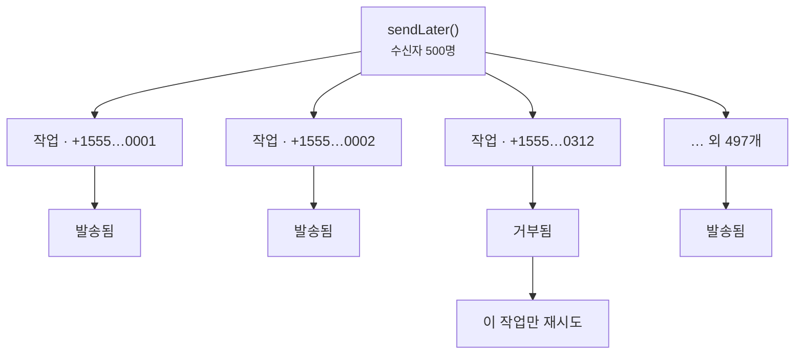

# 큐로 보내기

<p class="lead">제공업체와 통신하려면 네트워크 왕복이 필요하고, 때로는 꽤 느립니다. 웹 요청 중에 보내는 메시지는 큐에 넣어서, 앱 사용자가 통신망 응답을 기다리는 일이 없게 하세요.</p>

## 나중에 보내기 {#sending-later}

```php
Sms::to($user->phone)->message('Thanks for signing up!')->sendLater();
```

특정 시각에 보내려면 날짜, 시간 간격, 또는 초 단위 숫자를 넘기세요.

```php
Sms::to($user->phone)
    ->message('Your appointment is in one hour.')
    ->sendLaterAt($appointment->starts_at->subHour());
```

## 기본적으로 모두 큐에 넣기 {#queue-everything-by-default}

`SMS_QUEUE=true`로 설정하면 `send()`가 즉시 보내는 대신 큐에 넣습니다. 로그인 코드처럼 바로 보내야 할 때는 여전히 `sendNow()`로 즉시 보낼 수 있습니다.

```ini [.env]
SMS_QUEUE=true
SMS_QUEUE_CONNECTION=redis
SMS_QUEUE_NAME=sms
```

Laravel 13에서는 대신 `AppServiceProvider`에서 다른 큐 라우팅과 함께 패키지의 작업을 라우팅할 수도 있습니다.

```php
use Illuminate\Support\Facades\Queue;
use MrRijal\LaravelSms\Jobs\SendSmsJob;

public function boot(): void
{
    Queue::route(SendSmsJob::class, connection: 'redis', queue: 'sms');
}
```

전용 큐를 두면 대량의 마케팅 문자 때문에 비밀번호 재설정 문자가 늦어지는 일을 막을 수 있습니다. 이 큐를 처리할 워커를 실행하세요.

```bash
php artisan queue:work redis --queue=sms
```

## 수신자마다 작업 하나 {#one-job-per-recipient}

500명에게 보내는 메시지는 큰 작업 하나가 아니라 작은 작업 500개가 됩니다. 제공업체가 312번째 번호를 거부하면 그 작업만 실패하고 재시도되며, 나머지 499명에게는 메시지가 다시 가지 않습니다.



각 작업은 기본적으로 최대 세 번까지 시도하며, 시도 사이에 10초, 30초, 60초를 차례로 기다립니다.

```ini [.env]
SMS_QUEUE_TRIES=3
SMS_QUEUE_TIMEOUT=120
```

::: warning retry_after는 타임아웃보다 길게
큐 연결의 `retry_after`(`config/queue.php`)는 `SMS_QUEUE_TIMEOUT`보다 길어야 합니다. 그렇지 않으면 느리지만 결국 성공한 발송을 두 번째 워커가 다시 가져가 두 번 보낼 수 있습니다.
:::

## 저장 시 암호화 {#encrypted-at-rest}

큐 작업에는 전화번호와 메시지 본문이 담기며, 본문에는 로그인 코드가 들어 있는 경우가 많습니다. 모든 `SendSmsJob`은 Laravel의 `ShouldBeEncrypted`를 구현하므로, Redis나 데이터베이스, SQS에 머무는 동안 페이로드가 `APP_KEY`로 암호화됩니다.

## 중복 발송에 대해 {#about-duplicates}

수신자별로 작업을 나누면 가장 흔한 중복, 즉 잘못된 번호 하나 때문에 모든 사람에게 다시 보내지는 상황을 막을 수 있습니다. 하지만 더 드문 경우가 하나 남아 있고, 이는 어떤 SMS 시스템도 완전히 배제할 수 없습니다. 제공업체가 메시지를 접수했는데 응답이 돌아오기 전에 연결이 끊기는 경우입니다. 작업은 메시지가 나갔는지 알 수 없으므로 재시도하면서 다시 보낼 수 있습니다. 즉, 전송은 **최소 한 번(at least once)** 보장입니다.

중복 발송이 정말 문제가 되는 메시지라면 재시도 횟수를 낮게 잡고, 돌려받은 메시지 ID를 저장해 두세요.
