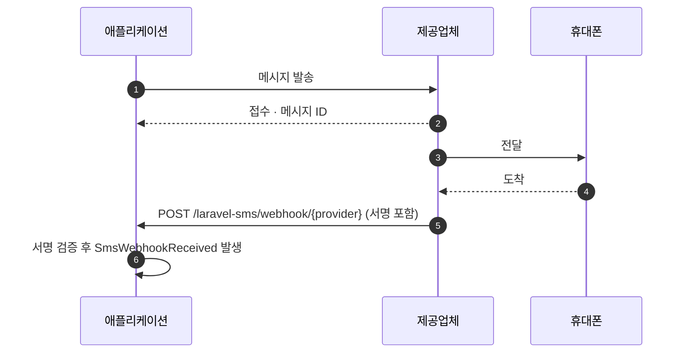

# 웹훅

<p class="lead">발송 결과는 제공업체가 메시지를 접수했다는 뜻일 뿐입니다. 그 이후에 무슨 일이 있었는지, 즉 도착했는지, 실패했는지, 받는 사람이 답장을 보냈는지는 웹훅이 알려 줍니다.</p>



## 웹훅 켜기 {#turning-them-on}

웹훅은 직접 켜기 전까지는 꺼져 있습니다.

```ini [.env]
SMS_WEBHOOKS_ENABLED=true
```

이렇게 하면 모든 제공업체가 함께 쓰는 라우트 하나가 등록됩니다.

```text
POST  /laravel-sms/webhook/{provider}     name: sms.webhook
```

각 제공업체에는 끝에 자기 키를 붙인 URL을 등록하세요. 예를 들면 `https://example.com/laravel-sms/webhook/termii`입니다.

웹훅을 지원하는 제공업체는 **WhatsApp, Termii, Sendchamp, Africa's Talking, BulkSMS**입니다.

## 모든 웹훅은 보낸 쪽을 증명해야 합니다 {#every-webhook-must-prove-who-sent-it}

웹훅 엔드포인트는 공개된 URL입니다. 검증하지 않으면 누구든 가짜 전송 보고서를 보낼 수 있습니다. 그래서 제공업체마다 시크릿이 필요하고, 그 시크릿을 안다는 것을 증명하지 못하는 요청은 `401`을 받습니다. 시크릿이 설정되지 않았다면 **모든** 요청을 거부합니다. 엔드포인트가 보호 없이 동작하는 일은 없습니다.

| 제공업체 | 변수 | 검증 방식 |
|---|---|---|
| WhatsApp | `WHATSAPP_WEBHOOK_SECRET` | Meta 앱 시크릿으로 서명한 본문의 HMAC, `X-Hub-Signature-256` |
| | `WHATSAPP_VERIFY_TOKEN` | Meta가 구독 시 한 번 보내는 `GET` 확인 요청에서 비교 |
| Termii | `TERMII_WEBHOOK_SECRET` | 본문의 HMAC-SHA512, `X-Termii-Signature` |
| Sendchamp | `SENDCHAMP_WEBHOOK_SECRET` | 본문의 HMAC-SHA256, `X-Sendchamp-Signature` |
| BulkSMS | `BULKSMS_WEBHOOK_SECRET` | 본문의 HMAC-SHA256, `X-BulkSMS-Signature` |
| Africa's Talking | `AFRICASTALKING_WEBHOOK_SECRET` | 콜백 URL의 `token` (아래 참고) |

### Africa's Talking {#africa-s-talking}

Africa's Talking은 콜백에 서명하지 않으므로, 시크릿을 Africa's Talking에 등록하는 URL에 넣습니다.

```text
https://example.com/laravel-sms/webhook/africastalking?token=your-long-random-secret
```

패키지는 토큰을 상수 시간(constant time)으로 비교한 뒤 페이로드에서 제거하므로, 리스너나 로그에는 토큰이 남지 않습니다. `php -r "echo bin2hex(random_bytes(24));"`의 출력처럼 길고 무작위한 값을 쓰세요.

### WhatsApp {#whatsapp}

WhatsApp은 두 값이 **모두** 필요합니다. Meta 대시보드에서 웹훅을 추가하면 Meta가 verify token을 담은 `GET` 요청을 보내고 challenge 값을 돌려받기를 기다립니다. 그 이후의 전송 보고서는 모두 앱 시크릿으로 서명된 `POST`로 도착합니다.

## 보고서 처리하기 {#handling-the-reports}

검증을 통과한 웹훅은 `SmsWebhookReceived` 이벤트를 발생시킵니다. `app/Listeners`에 리스너를 두면 Laravel이 자동으로 찾아 등록하니, 그 리스너에서 처리하세요.

```bash
php artisan make:listener UpdateSmsStatus --event="MrRijal\LaravelSms\Events\SmsWebhookReceived"
```

```php
namespace App\Listeners;

use App\Models\SmsLog;
use Illuminate\Contracts\Queue\ShouldQueue;
use MrRijal\LaravelSms\Events\SmsWebhookReceived;

class UpdateSmsStatus implements ShouldQueue
{
    public function handle(SmsWebhookReceived $event): void
    {
        SmsLog::where('provider_id', $event->messageId)
            ->update(['status' => $event->status]);
    }
}
```

리스너를 큐로 돌리면 웹훅이 제공업체에 즉시 응답할 수 있습니다. 제공업체는 응답이 느린 웹훅을 재전송합니다.

| 속성 | 내용 |
|---|---|
| `provider` | `whatsapp`, `termii`, … |
| `messageId` | 발송 시 돌려받은 ID (제공업체가 포함해 보낸 경우) |
| `status` | `delivered`, `failed`처럼 제공업체가 쓰는 상태 값 그대로 |
| `recipient` | 보고서가 가리키는 전화번호 |
| `payload` | 그 밖에 필요한 정보가 담긴 요청 본문 전체 |

상태 값은 제공업체마다 다릅니다. 모두 같은 용어를 쓴다고 가정하지 말고, 각 제공업체 문서와 대조하세요.

## 미들웨어와 경로 {#middleware-and-path}

라우트는 상태를 저장하지 않는 `api` 미들웨어 그룹과 분당 120회 요청 제한을 사용합니다. 웹훅에는 세션도 CSRF 토큰도 없습니다. 둘 다 `config/sms.php`에서 바꿀 수 있습니다.

```php
'webhooks' => [
    'enabled' => (bool) env('SMS_WEBHOOKS_ENABLED', false),
    'prefix' => env('SMS_WEBHOOKS_PREFIX', 'laravel-sms/webhook'),
    'middleware' => ['api', 'throttle:120,1'],
    // …
],
```

웹훅은 반드시 HTTPS로만 받으세요. 서명은 누가 요청을 보냈는지 증명할 뿐, 내용을 감춰 주지는 않습니다.
