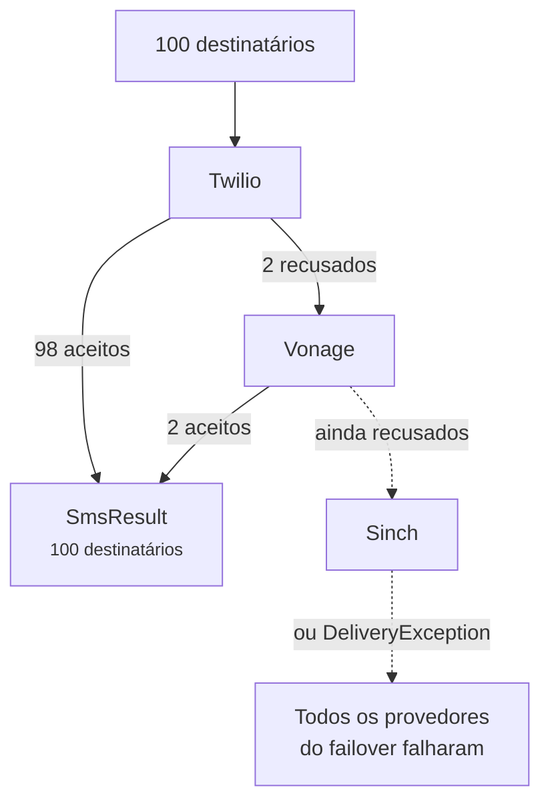

# Failover e balanceamento de carga

<p class="lead">Provedores saem do ar, e alguns funcionam melhor em certos países do que outros. Encadeie vários, e suas mensagens continuam saindo enquanto um deles está fora.</p>

## Failover {#failover}

Liste os provedores em ordem de preferência:

```ini [.env]
SMS_PROVIDER=failover
SMS_FAILOVER_DRIVERS=twilio,vonage,sinch
```

Cada mensagem vai primeiro para a Twilio. Se a Twilio não conseguir enviá-la, é a vez da Vonage, depois da Sinch. Cada provedor da cadeia precisa das próprias credenciais configuradas, como sempre.

Você também pode usar o failover só em algumas mensagens e deixar o seu padrão como está:

```php
Sms::provider('failover')->to($phone)->message('Your code is 4821')->sendNow();
```

### Só as falhas seguem adiante {#only-the-failures-move-on}

Digamos que você envie para 100 pessoas. A Twilio aceita 98 e recusa dois números que a rede dela não alcança. O failover envia **só esses dois** para a Vonage. As 98 pessoas que já receberam a mensagem não a recebem de novo.



```php
$result = Sms::provider('failover')->to($hundredNumbers)->message('Hi')->sendNow();

count($result);   // 100
$result->ids();   // 98 IDs da Twilio, depois 2 IDs da Vonage
```

### O que conta como falha {#what-counts-as-a-failure}

O failover passa para o próximo quando um provedor:

- recusa alguns ou todos os destinatários, ou não responde (uma `DeliveryException`),
- não está configurado ou está sem credenciais (uma `InvalidConfigurationException`),
- não consegue enviar esse tipo de mensagem, por exemplo um template para um provedor que só aceita texto (uma `InvalidMessageException`).

Se todos os provedores falharem, você recebe uma `DeliveryException` que começa com *All failover providers failed*. Ela lista os destinatários que ninguém aceitou, e a propriedade `partial` traz todos que receberam a mensagem.

::: tip Coloque primeiro o provedor confiável mais barato
Cada destinatário vai para o primeiro provedor que aceitar, então a ordem também é uma decisão de custo. Uma configuração típica é o seu provedor principal primeiro e uma segunda rede como reserva.
:::

## Balanceamento de carga {#load-balancing}

Para distribuir o tráfego entre vários provedores, use `random`. Cada mensagem vai para um provedor sorteado do seu pool:

```php
// config/sms.php
'random_drivers' => ['twilio', 'vonage'],
```

```ini [.env]
SMS_PROVIDER=random
```

O `random` sorteia uma vez por mensagem. Com [filas](/pt/guide/queueing), isso significa uma vez por destinatário, então um lote grande se distribui de forma equilibrada. Ele não tenta outro provedor em caso de falha; para isso, use o `failover`.
