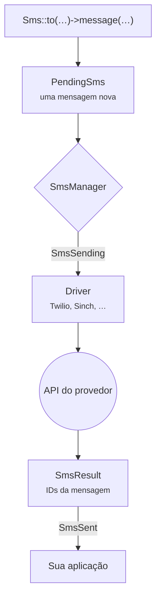

# Introdução

O Laravel SMS dá à sua aplicação uma única forma de enviar SMS, seja qual for o provedor do outro lado. Você escreve <code>Sms::to($number)->message($text)->send()</code> e o pacote cuida da API do provedor, das manias dela e das falhas.

## Por que ele existe

A maioria das aplicações começa com um provedor e um pequeno wrapper em volta do SDK dele. Esse wrapper vai crescendo. Aí o preço muda, um país passa a exigir um gateway local ou a entrega para uma operadora fica instável, e o wrapper precisa ganhar um segundo provedor. Toda aplicação acaba escrevendo a mesma infraestrutura: retentativas, IDs de remetente, limpeza de números de telefone, logs e testes.

Este pacote é essa infraestrutura, escrita uma vez só e testada em todas as versões suportadas de PHP e Laravel.

## O que você ganha

- **Uma API para vinte provedores.** Twilio, Vonage, Sinch, Bird, Plivo, Telnyx, Infobip, ClickSend, Clickatell, Brevo, Bandwidth, SendPulse, Amazon SNS e WhatsApp, além de gateways regionais para Índia, Nepal e África.
- **Respostas, não booleanos.** Um envio devolve os IDs de mensagem do provedor. Uma falha diz quais números foram recusados e quais passaram.
- **Failover sem duplicatas.** Encadeie provedores, e só os destinatários que um provedor recusou seguem para o próximo.
- **Laravel de ponta a ponta.** Um canal de notificação, jobs na fila, eventos, macros, `php artisan sms:test` e `Sms::fake()` para os seus testes.

## O caminho de uma mensagem

Cada chamada à facade começa uma mensagem totalmente nova, então nada vaza de um envio para outro, nem no Octane nem em um worker de fila que roda por muito tempo. O manager escolhe o provedor: o que você pediu, o seu padrão ou o próximo de uma cadeia de failover. O driver transforma sua mensagem na requisição HTTP do provedor e a resposta dele de volta em um `SmsResult`.

## Requisitos

| Laravel | PHP |
|---|---|
| 13.x | 8.3, 8.4, 8.5 |
| 12.x | 8.2, 8.3, 8.4, 8.5 |
| 11.x | 8.2, 8.3, 8.4, 8.5 |

::: warning Laravel 11
O Laravel 11 não recebe mais correções de segurança. O pacote continua dando suporte a ele para que aplicações existentes possam atualizar no seu próprio ritmo, mas projetos novos devem começar no Laravel 12 ou 13.
:::

## Próximos passos

Instale o pacote e envie sua primeira mensagem: leva uns dois minutos.

[Instalação →](/pt/guide/installation)

