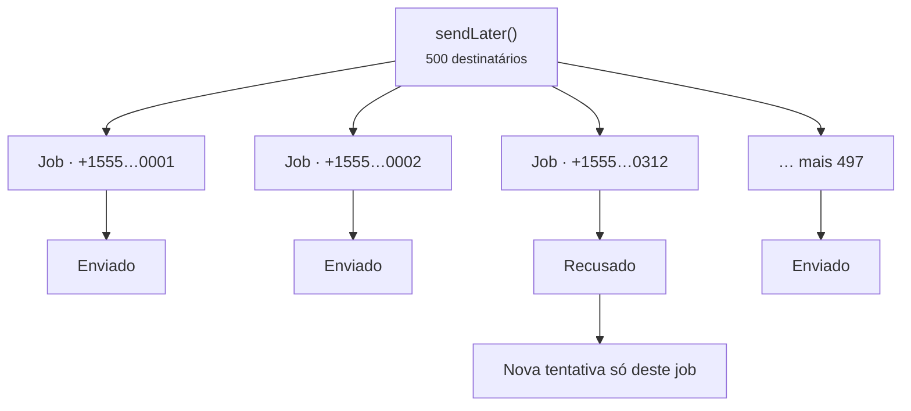

# Filas

<p class="lead">Falar com um provedor exige uma ida e volta pela rede, às vezes bem lenta. Coloque na fila as mensagens enviadas durante requisições web, assim quem usa sua aplicação nunca fica esperando a operadora.</p>

## Enviando depois

```php
Sms::to($user->phone)->message('Thanks for signing up!')->sendLater();
```

Para enviar em um horário específico, passe uma data, um intervalo ou um número de segundos:

```php
Sms::to($user->phone)
    ->message('Your appointment is in one hour.')
    ->sendLaterAt($appointment->starts_at->subHour());
```

## Tudo na fila por padrão

Defina `SMS_QUEUE=true` e o `send()` passa a colocar na fila em vez de enviar na hora. O `sendNow()` continua enviando imediatamente quando você precisa, por exemplo para códigos de login.

```ini [.env]
SMS_QUEUE=true
SMS_QUEUE_CONNECTION=redis
SMS_QUEUE_NAME=sms
```

No Laravel 13, você também pode rotear o job do pacote pelo `AppServiceProvider`, junto com o restante do seu roteamento de filas:

```php
use Illuminate\Support\Facades\Queue;
use MrRijal\LaravelSms\Jobs\SendSmsJob;

public function boot(): void
{
    Queue::route(SendSmsJob::class, connection: 'redis', queue: 'sms');
}
```

Uma fila dedicada evita que um lote grande de mensagens de marketing atrase as suas redefinições de senha. Rode um worker para ela:

```bash
php artisan queue:work redis --queue=sms
```

## Um job por destinatário

Uma mensagem para 500 pessoas vira 500 jobs pequenos, não um grande. Se o provedor recusar o 312º número, só esse job falha e é tentado de novo; os outros 499 destinatários nunca recebem a mensagem outra vez.



Por padrão, cada job é tentado até três vezes, com espera de 10, 30 e depois 60 segundos entre as tentativas:

```ini [.env]
SMS_QUEUE_TRIES=3
SMS_QUEUE_TIMEOUT=120
```

::: warning Mantenha o retry_after acima do timeout
O `retry_after` da sua conexão de fila (em `config/queue.php`) precisa ser maior que o `SMS_QUEUE_TIMEOUT`. Caso contrário, um envio lento mas bem-sucedido pode ser pego por um segundo worker e enviado duas vezes.
:::

## Criptografado em repouso

Os jobs na fila carregam números de telefone e o texto das mensagens, que muitas vezes inclui códigos de login. Todo `SendSmsJob` implementa o `ShouldBeEncrypted` do Laravel, então o payload fica criptografado com a sua `APP_KEY` enquanto está no Redis, no seu banco de dados ou no SQS.

## Sobre duplicatas

Separar os jobs por destinatário evita a duplicata mais comum: um número ruim fazendo todo mundo receber de novo. Sobra um caso mais raro, que nenhum sistema de SMS consegue eliminar por completo: o provedor aceita a mensagem, mas a conexão cai antes de a resposta chegar. O job não tem como saber que a mensagem saiu, então uma nova tentativa pode enviá-la outra vez. A entrega é **pelo menos uma vez** (at least once).

Para mensagens em que uma duplicata faria diferença de verdade, mantenha poucas tentativas e guarde o ID da mensagem que você recebe de volta.
