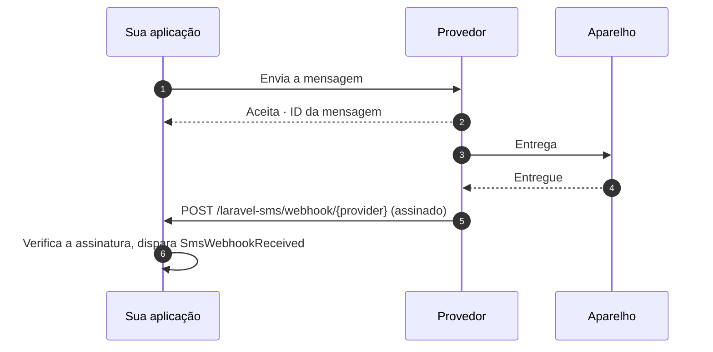

# Webhooks

<p class="lead">O resultado de um envio significa que o provedor aceitou sua mensagem. Os webhooks contam o que aconteceu depois: entregue, falhou ou uma resposta de quem recebeu o SMS.</p>



## Ativando

Os webhooks ficam desligados até você ativá-los:

```ini [.env]
SMS_WEBHOOKS_ENABLED=true
```

Isso registra uma rota para todos os provedores:

```text
POST  /laravel-sms/webhook/{provider}     name: sms.webhook
```

Passe para cada provedor a URL com a chave dele no final, por exemplo `https://example.com/laravel-sms/webhook/termii`.

Há suporte a webhooks para **WhatsApp, Termii, Sendchamp, Africa's Talking e BulkSMS**.

## Todo webhook precisa provar quem o enviou

Um endpoint de webhook é uma URL pública. Sem verificação, qualquer pessoa poderia mandar relatórios de entrega falsos para ela. Por isso cada provedor precisa de um segredo, e requisições que não conseguem provar que o conhecem recebem um `401`. Se o segredo não estiver configurado, **todas** as requisições são recusadas: o endpoint nunca roda desprotegido.

| Provedor | Variável | Como é verificado |
|---|---|---|
| WhatsApp | `WHATSAPP_WEBHOOK_SECRET` | HMAC `X-Hub-Signature-256` do corpo, assinado com o app secret da Meta |
| | `WHATSAPP_VERIFY_TOKEN` | Comparado durante a verificação única de assinatura via `GET` da Meta |
| Termii | `TERMII_WEBHOOK_SECRET` | `X-Termii-Signature`, HMAC-SHA512 do corpo |
| Sendchamp | `SENDCHAMP_WEBHOOK_SECRET` | `X-Sendchamp-Signature`, HMAC-SHA256 do corpo |
| BulkSMS | `BULKSMS_WEBHOOK_SECRET` | `X-BulkSMS-Signature`, HMAC-SHA256 do corpo |
| Africa's Talking | `AFRICASTALKING_WEBHOOK_SECRET` | Um `token` na URL de callback (veja abaixo) |

### Africa's Talking

A Africa's Talking não assina os callbacks, então o segredo vai na URL que você cadastra com eles:

```text
https://example.com/laravel-sms/webhook/africastalking?token=your-long-random-secret
```

O pacote compara o token em tempo constante e depois o remove do payload, para que ele nunca chegue aos seus listeners nem aos seus logs. Use um valor aleatório longo, por exemplo a saída de `php -r "echo bin2hex(random_bytes(24));"`.

### WhatsApp

O WhatsApp precisa dos **dois** valores. Quando você adiciona o webhook no painel da Meta, ela envia uma requisição `GET` com o seu verify token e espera receber um challenge de volta. A partir daí, cada relatório de entrega chega como um `POST` assinado com o seu app secret.

## Tratando os relatórios

Cada webhook verificado dispara o `SmsWebhookReceived`. Trate-o com um listener em `app/Listeners`, que o Laravel descobre automaticamente:

```bash
php artisan make:listener UpdateSmsStatus --event="MrRijal\LaravelSms\Events\SmsWebhookReceived"
```

```php
namespace App\Listeners;

use App\Models\SmsLog;
use Illuminate\Contracts\Queue\ShouldQueue;
use MrRijal\LaravelSms\Events\SmsWebhookReceived;

class UpdateSmsStatus implements ShouldQueue
{
    public function handle(SmsWebhookReceived $event): void
    {
        SmsLog::where('provider_id', $event->messageId)
            ->update(['status' => $event->status]);
    }
}
```

Colocar o listener na fila permite que o webhook responda ao provedor na hora. Os provedores reenviam webhooks que demoram a responder.

| Propriedade | Conteúdo |
|---|---|
| `provider` | `whatsapp`, `termii`, … |
| `messageId` | O ID que você recebeu no envio, quando o provedor o inclui |
| `status` | A palavra de status do próprio provedor, como `delivered` ou `failed` |
| `recipient` | O número de telefone a que o relatório se refere |
| `payload` | O corpo completo da requisição, para qualquer outra coisa de que você precise |

As palavras de status variam de um provedor para outro. Compare com a documentação do provedor em vez de supor um vocabulário único.

## Middleware e caminho

A rota usa o grupo de middleware `api`, que é stateless, e um rate limit de 120 requisições por minuto. Webhooks não têm sessão nem token CSRF. Ajuste os dois no `config/sms.php`:

```php
'webhooks' => [
    'enabled' => (bool) env('SMS_WEBHOOKS_ENABLED', false),
    'prefix' => env('SMS_WEBHOOKS_PREFIX', 'laravel-sms/webhook'),
    'middleware' => ['api', 'throttle:120,1'],
    // …
],
```

Sirva os webhooks somente por HTTPS. As assinaturas provam quem enviou a requisição, mas não escondem o conteúdo dela.
