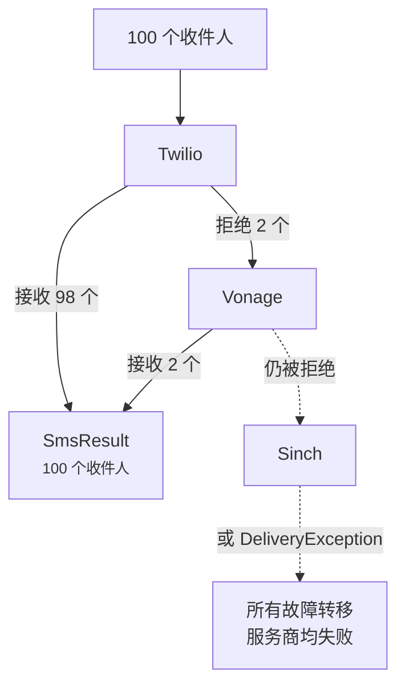

# 故障转移与负载均衡

<p class="lead">服务商难免宕机，而且各家在不同国家的表现也有好有坏。把它们串起来，即使其中一家挂了，短信也能照常发出。</p>

## 故障转移 {#failover}

按优先级列出你的服务商：

```ini [.env]
SMS_PROVIDER=failover
SMS_FAILOVER_DRIVERS=twilio,vonage,sinch
```

每条短信先交给 Twilio。Twilio 接不了，就轮到 Vonage，然后是 Sinch。链上的每家服务商都需要照常配置好各自的凭据。

也可以只为个别短信启用故障转移，默认配置保持不变：

```php
Sms::provider('failover')->to($phone)->message('Your code is 4821')->sendNow();
```

### 只有失败的部分会转交 {#only-the-failures-move-on}

假设你要发给 100 个人。Twilio 接收了 98 个，拒绝了两个它的网络无法触达的号码。故障转移只会把**这两个**交给 Vonage，已经收到短信的 98 个人不会再收到一遍。



```php
$result = Sms::provider('failover')->to($hundredNumbers)->message('Hi')->sendNow();

count($result);   // 100
$result->ids();   // 先是 98 个 Twilio ID，然后是 2 个 Vonage ID
```

### 什么算失败 {#what-counts-as-a-failure}

服务商出现以下情况时，故障转移会切到下一家：

- 拒绝了部分或全部收件人，或者无法连接（`DeliveryException`）；
- 没有配置，或缺少凭据（`InvalidConfigurationException`）；
- 不支持这类短信，例如把模板发给只支持文本的服务商（`InvalidMessageException`）。

如果所有服务商都失败了，你会收到一个以 *All failover providers failed* 开头的 `DeliveryException`。它会列出没有任何一家接收的收件人，其 `partial` 属性中则是所有已经收到短信的人。

::: tip 把最便宜又可靠的服务商放在第一位
每个收件人都会交给第一家愿意接收的服务商，所以顺序也决定了成本。常见做法是主力服务商排第一，另一家网络作为备用。
:::

## 负载均衡 {#load-balancing}

要把流量分摊到多家服务商，使用 `random`。每条短信会从你的服务商池中随机挑一家发送：

```php
// config/sms.php
'random_drivers' => ['twilio', 'vonage'],
```

```ini [.env]
SMS_PROVIDER=random
```

`random` 每条短信只挑一次。配合[队列发送](/zh/guide/queueing)时，就是每个收件人挑一次，所以大批量发送会分布得很均匀。它失败后不会换一家重试；需要重试请用 `failover`。
