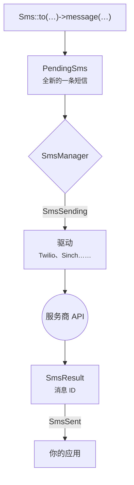

# 简介

不管背后是哪家服务商，Laravel SMS 都让你的应用用同一种方式发短信。你只需写 <code>Sms::to($number)->message($text)->send()</code>，服务商的 API、各种怪癖和失败处理都交给扩展包。

## 为什么要做这个包 {#why-it-exists}

大多数应用一开始只接一家服务商，在它的 SDK 外面包一层薄薄的封装。这层封装会越长越大。接着价格变了，某个国家需要本地网关，或者某个运营商的送达率开始不稳定，封装里又得塞进第二家服务商。最后每个应用都在重复写同一套底层代码：重试、发送方 ID、手机号清洗、日志和测试。

这个包就是那套底层代码，只写一次，并在所有受支持的 PHP 和 Laravel 版本上测试过。

## 你能得到什么 {#what-you-get}

- **一套 API，二十家服务商。** Twilio、Vonage、Sinch、Bird、Plivo、Telnyx、Infobip、ClickSend、Clickatell、Brevo、Bandwidth、SendPulse、Amazon SNS 和 WhatsApp，外加印度、尼泊尔和非洲的区域网关。
- **给你答案，而不是一个布尔值。** 发送会返回服务商的消息 ID。失败时会告诉你哪些号码被拒、哪些已经发出。
- **故障转移不会重复发送。** 把多家服务商串起来，只有被上一家拒绝的收件人才会交给下一家。
- **从头到尾都是 Laravel 风格。** 通知渠道、队列任务、事件、宏、`php artisan sms:test`，还有测试用的 `Sms::fake()`。

## 一条短信的旅程 {#how-a-message-travels}

每次调用 Facade 都会新建一条短信，所以两次发送之间不会互相串数据，在 Octane 或长时间运行的队列 worker 里也一样。由管理器决定用哪家服务商：你指定的那家、默认的那家，或者故障转移链中的下一家。驱动负责把短信转换成服务商的 HTTP 请求，再把响应转换回 `SmsResult`。

## 环境要求 {#requirements}

| Laravel | PHP |
|---|---|
| 13.x | 8.3、8.4、8.5 |
| 12.x | 8.2、8.3、8.4、8.5 |
| 11.x | 8.2、8.3、8.4、8.5 |

::: warning Laravel 11
Laravel 11 已不再提供安全修复。扩展包仍然支持它，好让现有应用按自己的节奏升级，但新项目请直接从 Laravel 12 或 13 开始。
:::

## 下一步 {#next-steps}

安装扩展包，发出第一条短信，大约只要两分钟。

[安装 →](/zh/guide/installation)

