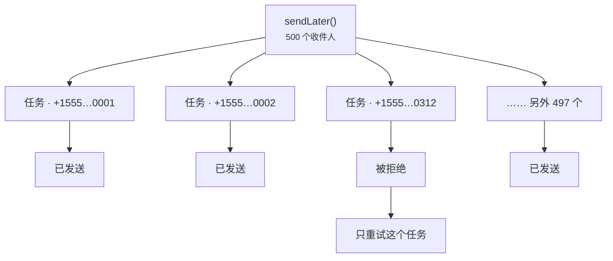

# 队列发送

<p class="lead">和服务商通信需要一次网络往返，有时还挺慢。在 Web 请求中发送的短信，放进队列，别让用户干等电信网络。</p>

## 稍后发送 {#sending-later}

```php
Sms::to($user->phone)->message('Thanks for signing up!')->sendLater();
```

要在特定时间发送，可以传入一个日期、一个时间间隔或秒数：

```php
Sms::to($user->phone)
    ->message('Your appointment is in one hour.')
    ->sendLaterAt($appointment->starts_at->subHour());
```

## 默认全部走队列 {#queue-everything-by-default}

设置 `SMS_QUEUE=true` 后，`send()` 会放进队列而不是立即发送。需要立刻发出时（比如登录验证码），`sendNow()` 照样直接发送。

```ini [.env]
SMS_QUEUE=true
SMS_QUEUE_CONNECTION=redis
SMS_QUEUE_NAME=sms
```

在 Laravel 13 中，也可以改在 `AppServiceProvider` 里为扩展包的任务配置路由，和你的其他队列路由放在一起：

```php
use Illuminate\Support\Facades\Queue;
use MrRijal\LaravelSms\Jobs\SendSmsJob;

public function boot(): void
{
    Queue::route(SendSmsJob::class, connection: 'redis', queue: 'sms');
}
```

单独用一个队列，大批量的营销短信就不会拖慢密码重置短信。为它启动一个 worker：

```bash
php artisan queue:work redis --queue=sms
```

## 每个收件人一个任务 {#one-job-per-recipient}

发给 500 人的短信会拆成 500 个小任务，而不是一个大任务。如果服务商拒绝了第 312 个号码，只有这个任务会失败并重试，其余 499 个收件人不会再收到第二遍。



默认情况下，每个任务最多尝试三次，两次尝试之间依次等待 10、30、60 秒：

```ini [.env]
SMS_QUEUE_TRIES=3
SMS_QUEUE_TIMEOUT=120
```

::: warning retry_after 要大于超时时间
队列连接的 `retry_after`（在 `config/queue.php` 中）必须比 `SMS_QUEUE_TIMEOUT` 长。否则一次慢但成功的发送可能会被另一个 worker 接手，导致短信发出两次。
:::

## 静态加密 {#encrypted-at-rest}

队列任务中带有手机号和短信内容，而内容里常常就是登录验证码。每个 `SendSmsJob` 都实现了 Laravel 的 `ShouldBeEncrypted`，所以它的载荷在 Redis、数据库或 SQS 里存放期间，始终用你的 `APP_KEY` 加密。

## 关于重复发送 {#about-duplicates}

按收件人拆分任务，避免了最常见的重复：一个坏号码导致所有人都被重发一遍。但还剩一种较少见的情况，任何短信系统都无法彻底排除：服务商已经接收了短信，可在它的响应返回之前连接断了。任务无法得知短信已经发出，重试时就可能再发一次。因此送达语义是**至少一次**（at least once）。

如果某些短信重复发送的后果确实严重，请把重试次数调低，并保存返回的消息 ID。
