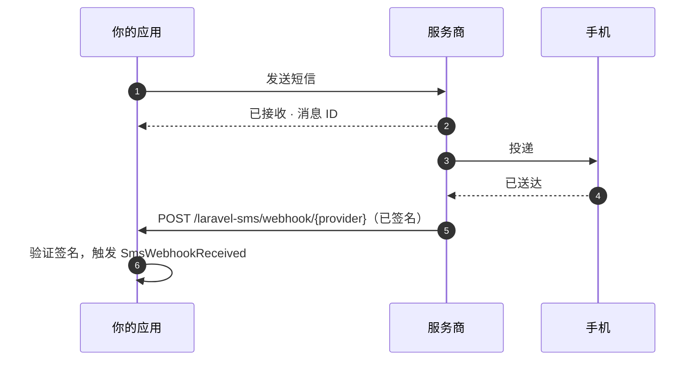

# Webhook 回调

<p class="lead">发送结果只说明服务商接收了你的短信。之后发生了什么，由 Webhook 告诉你：已送达、发送失败，或者收件人回复了你。</p>



## 开启 Webhook {#turning-them-on}

Webhook 默认关闭，需要手动开启：

```ini [.env]
SMS_WEBHOOKS_ENABLED=true
```

这会为所有服务商注册一条路由：

```text
POST  /laravel-sms/webhook/{provider}     name: sms.webhook
```

给每家服务商配置的 URL 末尾都带上它自己的标识，例如 `https://example.com/laravel-sms/webhook/termii`。

支持 Webhook 的服务商有 **WhatsApp、Termii、Sendchamp、Africa's Talking 和 BulkSMS**。

## 每个 Webhook 都必须证明来源 {#every-webhook-must-prove-who-sent-it}

Webhook 端点是一个公开的 URL。不做验证的话，任何人都能往里面提交伪造的送达报告。因此每家服务商都需要一个密钥，无法证明自己知道密钥的请求会收到 `401`。如果没有配置密钥，**所有**请求都会被拒绝：这个端点绝不会在无保护的状态下运行。

| 服务商 | 变量 | 校验方式 |
|---|---|---|
| WhatsApp | `WHATSAPP_WEBHOOK_SECRET` | 请求体的 `X-Hub-Signature-256` HMAC，用你的 Meta 应用密钥签名 |
| | `WHATSAPP_VERIFY_TOKEN` | 在 Meta 一次性的 `GET` 订阅校验中比对 |
| Termii | `TERMII_WEBHOOK_SECRET` | `X-Termii-Signature`，请求体的 HMAC-SHA512 |
| Sendchamp | `SENDCHAMP_WEBHOOK_SECRET` | `X-Sendchamp-Signature`，请求体的 HMAC-SHA256 |
| BulkSMS | `BULKSMS_WEBHOOK_SECRET` | `X-BulkSMS-Signature`，请求体的 HMAC-SHA256 |
| Africa's Talking | `AFRICASTALKING_WEBHOOK_SECRET` | 回调 URL 中的 `token`（见下文） |

### Africa's Talking {#africa-s-talking}

Africa's Talking 不对回调签名，所以密钥要放在你向它登记的 URL 里：

```text
https://example.com/laravel-sms/webhook/africastalking?token=your-long-random-secret
```

扩展包以恒定时间比较这个 token，然后把它从载荷中移除，因此它永远不会出现在你的监听器或日志里。请使用足够长的随机值，例如 `php -r "echo bin2hex(random_bytes(24));"` 的输出。

### WhatsApp {#whatsapp}

WhatsApp **两个**值都需要。在 Meta 控制台添加 Webhook 时，Meta 会带着你的 verify token 发来一个 `GET` 请求，并要求返回 challenge。此后，每份送达报告都会以 `POST` 请求送达，并用你的应用密钥签名。

## 处理送达报告 {#handling-the-reports}

每个通过验证的 Webhook 都会触发 `SmsWebhookReceived`。在 `app/Listeners` 中写一个监听器来处理它，Laravel 会自动发现：

```bash
php artisan make:listener UpdateSmsStatus --event="MrRijal\LaravelSms\Events\SmsWebhookReceived"
```

```php
namespace App\Listeners;

use App\Models\SmsLog;
use Illuminate\Contracts\Queue\ShouldQueue;
use MrRijal\LaravelSms\Events\SmsWebhookReceived;

class UpdateSmsStatus implements ShouldQueue
{
    public function handle(SmsWebhookReceived $event): void
    {
        SmsLog::where('provider_id', $event->messageId)
            ->update(['status' => $event->status]);
    }
}
```

把监听器放进队列，Webhook 就能立即响应服务商。响应慢的 Webhook 会被服务商重试。

| 属性 | 内容 |
|---|---|
| `provider` | `whatsapp`、`termii`…… |
| `messageId` | 发送时拿到的那个 ID（前提是服务商在回调里带上了它） |
| `status` | 服务商自己的状态词，例如 `delivered` 或 `failed` |
| `recipient` | 这份报告对应的手机号 |
| `payload` | 完整的请求体，其他需要的信息都在这里 |

各家服务商的状态词并不统一。请对照服务商的文档来判断，不要假设大家用的是同一套词汇。

## 中间件与路径 {#middleware-and-path}

这条路由使用无状态的 `api` 中间件组，限流为每分钟 120 次请求。Webhook 没有 session，也没有 CSRF token。两者都可以在 `config/sms.php` 中调整：

```php
'webhooks' => [
    'enabled' => (bool) env('SMS_WEBHOOKS_ENABLED', false),
    'prefix' => env('SMS_WEBHOOKS_PREFIX', 'laravel-sms/webhook'),
    'middleware' => ['api', 'throttle:120,1'],
    // …
],
```

Webhook 端点请只走 HTTPS。签名能证明请求是谁发的，但不能隐藏请求的内容。
